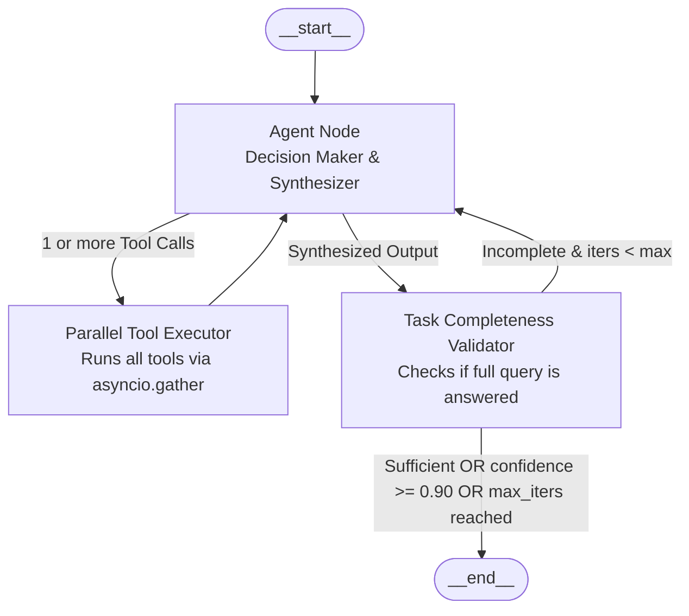

# 📚 AutoFlow LangGraph API Reference & Documentation

Comprehensive API documentation for the AutoFlow LangGraph-powered conversational agent backend.

---

## Table of Contents
1. [Architecture & LangGraph Overview](#1-architecture--langgraph-overview)
2. [State & Reducer Model (`add_messages`)](#2-state--reducer-model-add_messages)
3. [API Endpoints Reference](#3-api-endpoints-reference)
   - [POST `/api/chat/stream`](#post-apichatstream) *(Real-time SSE Streaming)*
   - [POST `/api/chat/invoke`](#post-apichatinvoke) *(One-shot Execution)*
   - [GET `/api/chat/threads/{thread_id}/history`](#get-apichatthreadsthread_idhistory)
   - [DELETE `/api/chat/threads/{thread_id}`](#delete-apichatthreadsthread_id)
   - [GET `/api/graph/schema`](#get-apigraphschema)
   - [GET `/api/graph/config`](#get-apigraphconfig)
4. [SSE Event Protocol Specification](#4-sse-event-protocol-specification)
5. [OpenAPI / Swagger Interactive Documentation](#5-openapi--swagger-interactive-documentation)

---

## 1. Architecture & LangGraph Overview

AutoFlow operates as a stateful, cyclical graph with **Unified Decision + Synthesizer**, **Parallel Tool Execution**, and **Task Completeness Control**:



### Graph Execution Lifecycle:
1. **`__start__`**: User query enters the workflow with a specific `thread_id`.
2. **`agent` node (Decision Maker + Synthesizer)**: The LLM evaluates the prompt, conversation history, and tool descriptions. If information or computations are needed, it emits **parallel tool calls** in a single turn. If tools have already run (or if no tools are needed), it synthesizes the final comprehensive Markdown response with LaTeX math, comparison tables, and citations directly.
3. **`tools` node (Parallel Executor)**: Executes all requested tools concurrently via `asyncio.gather()` in milliseconds and loops back directly to `agent`.
4. **`validator` node (Task Completeness Controller)**: Evaluates whether the generated response completely and exhaustively answers all parts, questions, and requirements of the user's prompt (especially for complex/multi-part queries). It does **NOT** fact-check truthfulness.
5. **Conditional Routing (`should_continue_validator`)**:
   - If **Complete** or **Confidence $\ge$ 90%** or **Max Iterations reached**: Routes to `__end__`.
   - If **Incomplete**: Loops back to `agent` with feedback on unaddressed aspects so generation continues until fully answered.
6. **`__end__`**: The conversation turns and state are persisted into the checkpointer and Supabase database.

---

## 2. State & Reducer Model

AutoFlow manages state using structured schemas with LangGraph and Python reducers:

```python
class ValidationResult(TypedDict, total=False):
    sufficient: bool
    confidence: float
    missing_information: List[str]
    issues: List[str]
    critique: str

class ExecutionStep(TypedDict, total=False):
    step_id: int
    node: str
    type: str  # 'agent', 'tool', 'validator', 'synthesizer'
    action: Optional[str]
    input: Optional[Dict[str, Any]]
    output: Optional[Dict[str, Any]]
    status: str  # 'success', 'running', 'failed', 'sufficient', 'insufficient', 'completed'
    latency_ms: Optional[float]
    iteration: int
    parent_step_id: Optional[int]
    timestamp: str

class AgentState(TypedDict):
    # 1. Conversation turns with LangGraph message reducer
    messages: Annotated[Sequence[BaseMessage], add_messages]
    
    # 2. Node & workflow tracking
    current_node: str
    status: str
    
    # 3. Research goal & accumulated evidence
    research_goal: Optional[str]
    evidence: List[Dict[str, Any]]
    
    # 4. Tool execution details
    last_tool_call: Optional[Dict[str, Any]]
    tool_results: List[Dict[str, Any]]
    
    # 5. Validation gate
    validation: ValidationResult
    
    # 6. Safety & loop bounds
    iteration_count: int
    max_iterations: int
    
    # 7. Step-by-step trace log with operator.add reducer
    execution_steps: Annotated[List[ExecutionStep], operator.add]
```

### How `add_messages` Works:
* **HumanMessage**: Added when the user sends a message.
* **AIMessage**: Appended when Gemini responds (or requests a tool).
* **ToolMessage**: Appended when tools execute and return data.
* **Session Persistence**: Stored against the `thread_id` in `MemorySaver`. When you send the next query with the same `thread_id`, the full conversation context is automatically loaded!

---

## 3. API Endpoints Reference

---

### `POST /api/chat/stream`
> **Real-Time Streaming Chat (Server-Sent Events)**

Streams graph node lifecycle events, tool invocations, and text tokens chunk-by-chunk in real time.

#### 🔹 Input:
* **Content-Type**: `application/json`
* **Body Parameters**:
  ```json
  {
    "message": "What is 25 * 4 and what is the capital of France?",
    "thread_id": "thread_1727451200_abc123",
    "history": [
      {"role": "user", "content": "Hi, I'm Alex."},
      {"role": "assistant", "content": "Hello Alex! How can I help you today?"}
    ]
  }
  ```

| Field | Type | Required | Description |
| :--- | :--- | :--- | :--- |
| `message` | `string` | **Yes** | The user prompt or question to process. |
| `thread_id` | `string` | No | Conversation session ID for memory persistence. (Autogenerated if omitted). |
| `history` | `array` | No | Initial conversation messages if creating a thread for the first time. |

#### 🔹 Process:
1. Verifies if `thread_id` has prior state in the memory checkpointer.
2. Yields `node_start` event for `__start__` and `agent`.
3. Calls Gemini asynchronously (`await model.ainvoke()`).
4. Emits `tool_start` and `tool_end` if Gemini calls tools.
5. Emits `token` events in real-time as Gemini streams markdown characters (`{"delta": "..."}`).
6. Saves the updated state into the checkpointer and emits `done`.

#### 🔹 Output:
* **Content-Type**: `text/event-stream`
* **Stream of SSE Events**:
  ```sse
  event: node_start
  data: {"node": "__start__", "label": "Start", "action": "Received user message", "thread_id": "thread_1727451200_abc123"}

  event: node_start
  data: {"node": "agent", "name": "agent", "timestamp": 1727451201.2, "thread_id": "thread_1727451200_abc123"}

  event: tool_start
  data: {"node": "tools", "tool_name": "calculate", "input": {"expression": "25 * 4"}, "thread_id": "thread_1727451200_abc123"}

  event: tool_end
  data: {"node": "tools", "tool_name": "calculate", "output": "Result of `25 * 4` = 100", "thread_id": "thread_1727451200_abc123"}

  event: token
  data: {"delta": "The", "thread_id": "thread_1727451200_abc123"}

  event: token
  data: {"delta": " result is **100**.", "thread_id": "thread_1727451200_abc123"}

  event: node_start
  data: {"node": "__end__", "label": "End", "action": "Workflow complete", "thread_id": "thread_1727451200_abc123"}

  event: done
  data: {"status": "completed", "thread_id": "thread_1727451200_abc123"}
  ```

---

### `POST /api/chat/invoke`
> **One-Shot Synchronous Chat Invocation**

Executes the entire LangGraph flow and returns the completed answer and trace once all processing is finished.

#### 🔹 Input:
* **Content-Type**: `application/json`
* **Body Parameters**:
  ```json
  {
    "message": "Calculate sqrt(144) + 10",
    "thread_id": "thread_1727451200_abc123"
  }
  ```

#### 🔹 Process:
1. Loads thread state from `memory_checkpointer`.
2. Asynchronously runs the graph via `await chatbot_graph.ainvoke(input_payload, config=config)`.
3. Handles all multi-step tool calls and LLM reasoning steps internally.
4. Returns the final structured response.

#### 🔹 Output:
* **Status**: `200 OK`
* **Body**:
  ```json
  {
    "thread_id": "thread_1727451200_abc123",
    "response": "The result of $\\sqrt{144} + 10$ is **22**.",
    "execution_steps": [
      {
        "step_id": 1,
        "node": "agent",
        "action": "Calling 1 tool(s): ['calculate']",
        "timestamp": "12:45:01.120",
        "details": {
          "has_tool_calls": true,
          "tool_calls": [{"name": "calculate", "args": {"expression": "sqrt(144) + 10"}}]
        },
        "latency_ms": 940.5
      },
      {
        "step_id": 2,
        "node": "tools",
        "action": "Executed 1 tool output(s)",
        "timestamp": "12:45:01.125",
        "details": {
          "executed_tools": [{"tool_name": "calculate", "content_preview": "Result of `sqrt(144) + 10` = 22.0"}]
        },
        "latency_ms": 1.2
      },
      {
        "step_id": 3,
        "node": "agent",
        "action": "Generated final Markdown response",
        "timestamp": "12:45:02.100",
        "details": {"has_tool_calls": false},
        "latency_ms": 970.0
      }
    ],
    "status": "completed"
  }
  ```

---

### `GET /api/chat/threads/{thread_id}/history`
> **Retrieve Persisted Thread History**

Retrieves all messages stored inside the LangGraph checkpointer for a given session.

#### 🔹 Input:
* **Path Parameter**: `thread_id` (string)

#### 🔹 Process:
1. Queries `chatbot_graph.get_state({"configurable": {"thread_id": thread_id}})`.
2. Serializes `HumanMessage`, `AIMessage`, and `ToolMessage` turns into JSON.

#### 🔹 Output:
```json
{
  "thread_id": "thread_1727451200_abc123",
  "messages": [
    {"role": "user", "content": "Hi, my name is Alex."},
    {"role": "assistant", "content": "Hello Alex! How can I help you?"},
    {"role": "user", "content": "What is my name?"},
    {"role": "assistant", "content": "Your name is Alex."}
  ],
  "current_node": "agent",
  "execution_steps": [...]
}
```

---

### `DELETE /api/chat/threads/{thread_id}`
> **Clear Thread Memory**

Deletes all conversation state and checkpoint data for a specific thread ID.

#### 🔹 Input:
* **Path Parameter**: `thread_id` (string)

#### 🔹 Output:
```json
{
  "status": "cleared",
  "thread_id": "thread_1727451200_abc123"
}
```

---

### `GET /api/graph/schema`
> **Get Graph Topology Schema for UI Visualizer**

Returns the node and edge definitions of the workflow.

#### 🔹 Output:
```json
{
  "nodes": [
    {"id": "__start__", "label": "Start", "type": "start", "icon": "Play", "color": "#10b981"},
    {"id": "agent", "label": "Gemini Agent", "type": "llm", "icon": "Brain", "color": "#6366f1"},
    {"id": "tools", "label": "Tools Execution", "type": "tool", "icon": "Wrench", "color": "#ec4899"},
    {"id": "__end__", "label": "End / Output", "type": "end", "icon": "CheckCircle2", "color": "#14b8a6"}
  ],
  "edges": [
    {"from": "__start__", "to": "agent", "type": "direct", "label": "Invoke"},
    {"from": "agent", "to": "tools", "type": "conditional", "label": "Needs Tools"},
    {"from": "tools", "to": "agent", "type": "loop", "label": "Return Tool Results"},
    {"from": "agent", "to": "__end__", "type": "conditional", "label": "Final Answer"}
  ],
  "tools": [
    {"name": "calculate", "description": "Safe mathematical expression evaluation"},
    {"name": "web_search", "description": "Live Tavily web search with AI summary & sources"},
    {"name": "get_current_time", "description": "Accurate timezone and datetime information"},
    {"name": "process_image", "description": "Multimodal visual QA, OCR, and photo analysis (max 5 MB; PNG, JPEG, WEBP, HEIC, HEIF)"},
    {"name": "google_email_mcp", "description": "Google Email MCP to search, fetch, and read emails from Gmail"}
  ],
  "model": "gemini-3.1-flash-lite"
}
```

---

### `GET /api/graph/config`
> **Get Runtime Model Configuration**

#### 🔹 Output:
```json
{
  "model": "gemini-3.5-flash-lite",
  "temperature": 0.7,
  "api_key_configured": true
}
```

---

## 4. SSE Event Protocol Specification

When consuming `/api/chat/stream`, the frontend listens for these specific SSE event names:

| SSE Event Name | Data Payload Structure | Meaning / Action |
| :--- | :--- | :--- |
| `node_start` | `{"node": "agent", "thread_id": "..."}` | Highlight node as active in graph canvas. |
| `node_end` | `{"node": "agent", "output": "...", "thread_id": "..."}` | Node finished execution. |
| `tool_start` | `{"node": "tools", "tool_name": "...", "input": {...}}` | Tool started. Show tool execution badge in thoughts. |
| `tool_end` | `{"node": "tools", "tool_name": "...", "output": "..."}` | Tool completed. Populate tool result in thoughts disclosure. |
| `token` | `{"delta": "text chunk", "thread_id": "..."}` | Append chunk to streaming assistant bubble. |
| `done` | `{"status": "completed", "thread_id": "..."}` | Streaming finished; deactivate active graph nodes. |
| `error` | `{"error": "error message", "thread_id": "..."}` | Execution failed; display error banner to user. |

---

## 5. OpenAPI / Swagger Interactive Documentation

FastAPI automatically serves interactive Swagger UI and ReDoc documentation:

* **Swagger UI (Interactive Playground)**: [http://localhost:8000/docs](http://localhost:8000/docs)
* **ReDoc (API Specification)**: [http://localhost:8000/redoc](http://localhost:8000/redoc)
* **OpenAPI Raw JSON Schema**: [http://localhost:8000/openapi.json](http://localhost:8000/openapi.json)
