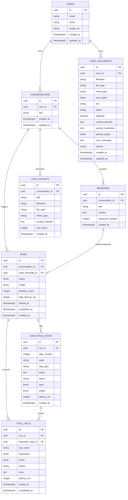
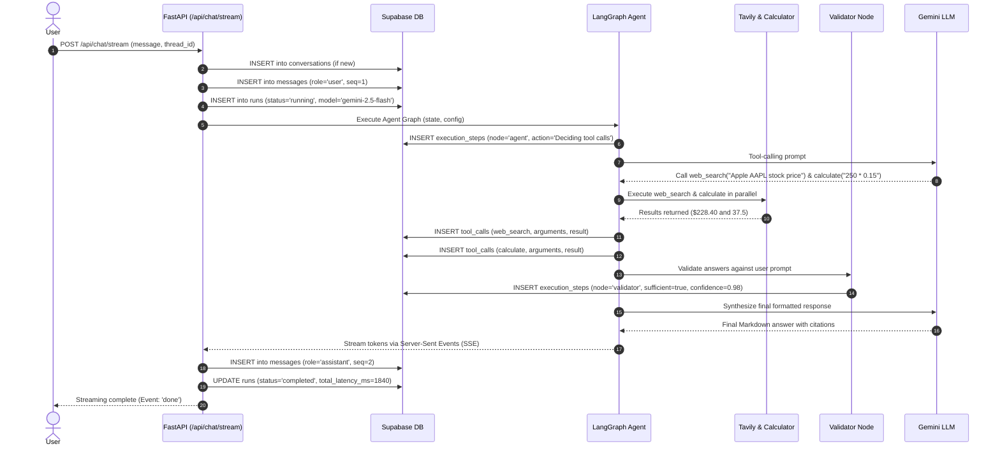
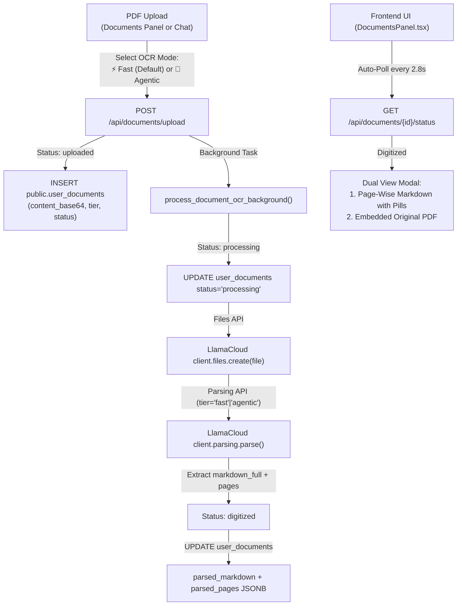

# AutoFlow Database & System Architecture Documentation

This document provides complete architectural specifications, entity-relationship models, schema definitions, security policies, and real-world query execution traces for the **AutoFlow** system running on **Supabase PostgreSQL** with **LangGraph**, **Gemini LLM**, and **LlamaCloud OCR**.

---

## 1. Architectural Overview & Entity Hierarchy

AutoFlow decouples user-facing conversation history from internal multi-agent execution traces, document repositories, and export artifacts:

```
users (Public Profiles synchronized with Supabase auth.users)
├── conversations (Persistent Chat Sessions)
│   ├── messages (Chronological User & Assistant Messages)
│   ├── runs (Workflow Executions triggered per turn)
│   │   ├── execution_steps (LangGraph Node Visits: agent, tools, validator)
│   │   └── tool_calls (First-Class Tool Invocations: web_search, calculate, etc.)
│   └── chat_exports (Generated TXT, PDF, and XLSX exports)
│
└── user_documents (Digitized PDFs, Images, DOCX, & Excel files)
    └── parsed_pages (Structured JSONB page-wise OCR Markdown via LlamaCloud)
```

### Key Architectural Layers:
1. **Conversational Layer** (`conversations`, `messages`):
   - Stores human-readable message transcripts, clean conversational history, and sliding-window memory checkpoints.
2. **Execution & Traceability Layer** (`runs`, `execution_steps`, `tool_calls`):
   - Logs detailed agent telemetry, node state transitions, tool inputs/outputs, model parameters, and latencies.
3. **Document Management & OCR Layer** (`user_documents`):
   - Stores uploaded PDF and image files with live status lifecycle (`uploaded` $\rightarrow$ `processing` $\rightarrow$ `digitized`), supporting dual LlamaCloud OCR modes: **⚡ Fast** and **🧠 Agentic**.
4. **Export Artifact Layer** (`chat_exports`):
   - Caches downloadable styled PDFs, Excel spreadsheets, and plain text transcripts.

---

## 2. Complete Entity-Relationship Diagram (ERD)



---

## 3. Database Schema Specifications

### 3.1. `users`
Synchronized with Supabase `auth.users` via database triggers.

| Column | Type | Constraints | Description |
| :--- | :--- | :--- | :--- |
| `id` | `UUID` | `PRIMARY KEY, REFERENCES auth.users(id) ON DELETE CASCADE` | Supabase Auth UID |
| `email` | `VARCHAR(255)` | `UNIQUE, NOT NULL` | User email address |
| `name` | `VARCHAR(255)` | `NULLABLE` | Display name / Google OAuth full name |
| `avatar_url` | `TEXT` | `NULLABLE` | Profile picture URL |
| `created_at` | `TIMESTAMPTZ` | `NOT NULL, DEFA
ULT now()` | Account creation time |
| `updated_at` | `TIMESTAMPTZ` | `NOT NULL, DEFAULT now()` | Last update timestamp |

---

### 3.2. `conversations`
Persistent chat threads.

| Column | Type | Constraints | Description |
| :--- | :--- | :--- | :--- |
| `id` | `UUID` | `PRIMARY KEY, DEFAULT gen_random_uuid()` | Thread ID |
| `user_id` | `UUID` | `NOT NULL, REFERENCES users(id) ON DELETE CASCADE` | Owner user ID |
| `title` | `VARCHAR(255)` | `DEFAULT 'New Conversation'` | Topic title auto-generated from prompt |
| `created_at` | `TIMESTAMPTZ` | `NOT NULL, DEFAULT now()` | Creation timestamp |
| `updated_at` | `TIMESTAMPTZ` | `NOT NULL, DEFAULT now()` | Last message timestamp |

**Indexes**: `idx_conversations_user_id` on `(user_id)`, `idx_conversations_updated_at` on `(updated_at DESC)`

---

### 3.3. `messages`
Human prompts and assistant answers.

| Column | Type | Constraints | Description |
| :--- | :--- | :--- | :--- |
| `id` | `UUID` | `PRIMARY KEY, DEFAULT gen_random_uuid()` | Unique message ID |
| `conversation_id` | `UUID` | `NOT NULL, REFERENCES conversations(id) ON DELETE CASCADE` | Parent conversation |
| `role` | `VARCHAR(30)` | `NOT NULL, CHECK (role IN ('user', 'assistant', 'system'))` | Message author |
| `content` | `TEXT` | `NULLABLE` | Markdown message content |
| `sequence_number` | `INTEGER` | `NOT NULL` | Sequential turn index (1, 2, 3...) |
| `created_at` | `TIMESTAMPTZ` | `NOT NULL, DEFAULT now()` | Message timestamp |

**Indexes**: `idx_messages_conversation_id` on `(conversation_id)`, `idx_messages_seq` on `(conversation_id, sequence_number ASC)`

---

### 3.4. `runs`
Tracks single-turn agent execution workflows.

| Column | Type | Constraints | Description |
| :--- | :--- | :--- | :--- |
| `id` | `UUID` | `PRIMARY KEY, DEFAULT gen_random_uuid()` | Unique run ID |
| `conversation_id` | `UUID` | `NOT NULL, REFERENCES conversations(id) ON DELETE CASCADE` | Parent conversation |
| `status` | `VARCHAR(30)` | `NOT NULL, DEFAULT 'started'` (`started`, `running`, `completed`, `error`, `aborted`) | Execution status |
| `input_message_id` | `UUID` | `REFERENCES messages(id) ON DELETE SET NULL` | Prompt message that triggered the run |
| `model` | `VARCHAR(100)` | `DEFAULT 'gemini-2.5-flash'` | Primary reasoning LLM |
| `iteration_count` | `INTEGER` | `DEFAULT 0` | Loop count between agent & validator |
| `total_latency_ms`| `INTEGER` | `NULLABLE` | End-to-end execution latency in ms |
| `started_at` | `TIMESTAMPTZ` | `DEFAULT now()` | Start timestamp |
| `completed_at` | `TIMESTAMPTZ` | `NULLABLE` | Completion timestamp |
| `created_at` | `TIMESTAMPTZ` | `NOT NULL, DEFAULT now()` | Record creation timestamp |

**Indexes**: `idx_runs_conversation_id` on `(conversation_id)`, `idx_runs_status` on `(status)`

---

### 3.5. `execution_steps`
Detailed node-by-node execution history for visual flowchart rendering.

| Column | Type | Constraints | Description |
| :--- | :--- | :--- | :--- |
| `id` | `UUID` | `PRIMARY KEY, DEFAULT gen_random_uuid()` | Unique step ID |
| `run_id` | `UUID` | `NOT NULL, REFERENCES runs(id) ON DELETE CASCADE` | Parent run |
| `step_number` | `INTEGER` | `NOT NULL` | Chronological step order |
| `node` | `VARCHAR(100)` | `NOT NULL` | Visited node (`__start__`, `agent`, `tools`, `validator`, `__end__`) |
| `step_type` | `VARCHAR(50)` | `NULLABLE` | Node classification (`agent`, `tool`, `validator`) |
| `action` | `TEXT` | `NULLABLE` | Human-readable action description |
| `status` | `VARCHAR(30)` | `DEFAULT 'success'` | Node status |
| `input` | `JSONB` | `NULLABLE` | Sanitized input payload |
| `output` | `JSONB` | `NULLABLE` | Sanitized output payload |
| `latency_ms` | `INTEGER` | `NULLABLE` | Node execution time in ms |
| `created_at` | `TIMESTAMPTZ` | `NOT NULL, DEFAULT now()` | Creation timestamp |

**Indexes**: `idx_execution_steps_run_id` on `(run_id)`, `idx_execution_steps_step_num` on `(run_id, step_number ASC)`

---

### 3.6. `tool_calls`
First-class records for individual tool invocations.

| Column | Type | Constraints | Description |
| :--- | :--- | :--- | :--- |
| `id` | `UUID` | `PRIMARY KEY, DEFAULT gen_random_uuid()` | Unique tool call ID |
| `run_id` | `UUID` | `NOT NULL, REFERENCES runs(id) ON DELETE CASCADE` | Parent run |
| `execution_step_id` | `UUID` | `REFERENCES execution_steps(id) ON DELETE CASCADE` | Associated step |
| `tool_name` | `VARCHAR(100)` | `NOT NULL` | Name of tool (`web_search`, `calculate`, `web_scrape`, etc.) |
| `arguments` | `JSONB` | `NULLABLE` | Tool arguments (e.g., `{"query": "..."}`) |
| `result` | `JSONB` | `NULLABLE` | Tool output and sources |
| `status` | `VARCHAR(30)` | `DEFAULT 'completed'` (`running`, `completed`, `error`, `failed`) | Execution status |
| `error` | `TEXT` | `NULLABLE` | Error message if failed |
| `latency_ms` | `INTEGER` | `NULLABLE` | Tool execution duration in ms |
| `started_at` | `TIMESTAMPTZ` | `DEFAULT now()` | Start timestamp |
| `completed_at` | `TIMESTAMPTZ` | `NULLABLE` | Completion timestamp |

**Indexes**: `idx_tool_calls_run_id` on `(run_id)`, `idx_tool_calls_tool_name` on `(tool_name)`

---

### 3.7. `chat_exports` (NEW - Migration 002)
Stores Base64-encoded downloadable export files (PDF, Excel XLSX, Plain Text TXT).

| Column | Type | Constraints | Description |
| :--- | :--- | :--- | :--- |
| `id` | `UUID` | `PRIMARY KEY, DEFAULT gen_random_uuid()` | Unique export ID |
| `conversation_id` | `UUID` | `REFERENCES conversations(id) ON DELETE CASCADE` | Associated conversation |
| `title` | `VARCHAR(255)` | `NOT NULL` | Document title |
| `filename` | `VARCHAR(255)` | `NOT NULL` | Export filename (e.g. `transcript_export.pdf`) |
| `file_type` | `VARCHAR(20)` | `NOT NULL, CHECK (file_type IN ('txt', 'pdf', 'xlsx'))` | Format category |
| `mime_type` | `VARCHAR(150)` | `NOT NULL` | HTTP MIME type |
| `content_base64` | `TEXT` | `NOT NULL` | Base64-encoded binary content |
| `size_bytes` | `INTEGER` | `NOT NULL, DEFAULT 0` | File size in bytes |
| `created_at` | `TIMESTAMPTZ` | `NOT NULL, DEFAULT now()` | Export timestamp |

**Indexes**: `idx_chat_exports_conv_id` on `(conversation_id)`, `idx_chat_exports_created_at` on `(created_at DESC)`

---

### 3.8. `user_documents` (NEW - Migration 003)
Stores uploaded documents (PDF, Excel, Images, DOCX) and their LlamaCloud OCR parsed results.

| Column | Type | Constraints | Description |
| :--- | :--- | :--- | :--- |
| `id` | `UUID` | `PRIMARY KEY, DEFAULT gen_random_uuid()` | Document ID |
| `user_id` | `UUID` | `REFERENCES users(id) ON DELETE CASCADE` | Owner user ID (`NULL` for guest) |
| `filename` | `VARCHAR(255)` | `NOT NULL` | Document filename |
| `file_type` | `VARCHAR(50)` | `NOT NULL, DEFAULT 'pdf'` | File type (`pdf`, `excel`, `image`, `docx`) |
| `mime_type` | `VARCHAR(150)` | `NOT NULL, DEFAULT 'application/pdf'` | MIME type |
| `size_bytes` | `BIGINT` | `NOT NULL, DEFAULT 0` | Document size in bytes |
| `tier` | `VARCHAR(20)` | `NOT NULL, DEFAULT 'fast' CHECK (tier IN ('fast', 'agentic'))` | LlamaCloud OCR tier |
| `status` | `VARCHAR(50)` | `NOT NULL, DEFAULT 'uploaded' CHECK (status IN ('uploaded', 'processing', 'digitized', 'failed'))` | Live processing state |
| `digitized` | `BOOLEAN` | `NOT NULL, DEFAULT false` | Whether OCR is complete |
| `content_base64` | `TEXT` | `NOT NULL` | Original file Base64 content |
| `parsed_markdown` | `TEXT` | `NULLABLE` | Full extracted Markdown text |
| `parsed_pages` | `JSONB` | `DEFAULT '[]'::jsonb` | Page-by-page array: `[{"page_number": 1, "markdown": "..."}]` |
| `error_message` | `TEXT` | `NULLABLE` | Error message if processing failed |
| `source` | `VARCHAR(50)` | `DEFAULT 'upload' CHECK (source IN ('upload', 'chat'))` | Upload origin |
| `created_at` | `TIMESTAMPTZ` | `NOT NULL, DEFAULT now()` | Upload timestamp |
| `updated_at` | `TIMESTAMPTZ` | `NOT NULL, DEFAULT now()` | Status update timestamp |

**Indexes**: `idx_user_documents_user_id` on `(user_id)`, `idx_user_documents_status` on `(status)`, `idx_user_documents_created_at` on `(created_at DESC)`

---

## 4. Row Level Security (RLS) Policies

All tables enforce Row Level Security in PostgreSQL:

```sql
-- Enable RLS across all tables
ALTER TABLE public.users ENABLE ROW LEVEL SECURITY;
ALTER TABLE public.conversations ENABLE ROW LEVEL SECURITY;
ALTER TABLE public.messages ENABLE ROW LEVEL SECURITY;
ALTER TABLE public.runs ENABLE ROW LEVEL SECURITY;
ALTER TABLE public.execution_steps ENABLE ROW LEVEL SECURITY;
ALTER TABLE public.tool_calls ENABLE ROW LEVEL SECURITY;
ALTER TABLE public.chat_exports ENABLE ROW LEVEL SECURITY;
ALTER TABLE public.user_documents ENABLE ROW LEVEL SECURITY;

-- 1. Users can only access their own profile
CREATE POLICY "Users can view and update own profile"
    ON public.users FOR ALL USING (auth.uid() = id);

-- 2. Conversations scoped to user_id
CREATE POLICY "Users can CRUD their own conversations"
    ON public.conversations FOR ALL USING (auth.uid() = user_id);

-- 3. Messages scoped via conversation ownership
CREATE POLICY "Users can CRUD messages in their conversations"
    ON public.messages FOR ALL USING (
        EXISTS (SELECT 1 FROM public.conversations c WHERE c.id = messages.conversation_id AND c.user_id = auth.uid())
    );

-- 4. Runs scoped via conversation ownership
CREATE POLICY "Users can CRUD runs in their conversations"
    ON public.runs FOR ALL USING (
        EXISTS (SELECT 1 FROM public.conversations c WHERE c.id = runs.conversation_id AND c.user_id = auth.uid())
    );

-- 5. Execution Steps scoped via runs -> conversations
CREATE POLICY "Users can CRUD execution steps for their runs"
    ON public.execution_steps FOR ALL USING (
        EXISTS (
            SELECT 1 FROM public.runs r
            JOIN public.conversations c ON c.id = r.conversation_id
            WHERE r.id = execution_steps.run_id AND c.user_id = auth.uid()
        )
    );

-- 6. Tool Calls scoped via runs -> conversations
CREATE POLICY "Users can CRUD tool calls for their runs"
    ON public.tool_calls FOR ALL USING (
        EXISTS (
            SELECT 1 FROM public.runs r
            JOIN public.conversations c ON c.id = r.conversation_id
            WHERE r.id = tool_calls.run_id AND c.user_id = auth.uid()
        )
    );

-- 7. Chat Exports: Service role full access, public download by ID
CREATE POLICY "Allow service role full access to chat_exports"
    ON public.chat_exports FOR ALL TO service_role USING (true) WITH CHECK (true);
CREATE POLICY "Allow public download access to chat_exports"
    ON public.chat_exports FOR SELECT TO public, anon, authenticated USING (true);

-- 8. User Documents: Authenticated access scoped to user_id, anon access for guest documents
CREATE POLICY "Allow service role full access to user_documents"
    ON public.user_documents FOR ALL TO service_role USING (true) WITH CHECK (true);
CREATE POLICY "Allow users to manage their own documents"
    ON public.user_documents FOR ALL TO authenticated USING (auth.uid() = user_id) WITH CHECK (auth.uid() = user_id);
CREATE POLICY "Allow anon access for guest documents"
    ON public.user_documents FOR ALL TO anon, public USING (user_id IS NULL) WITH CHECK (user_id IS NULL);
```

---

## 5. End-to-End Query Lifecycle: How an LLM Query is Processed and Saved

### Scenario:
A user asks:  
> **"What is the current stock price of Apple and what is 15% tax on $250?"**

Here is the exact step-by-step trace of how the LangGraph multi-agent pipeline processes this request and how each database table is populated.



### Exact Database Records Created:

#### Step 1: Conversation & User Message Insert
```sql
-- 1. Conversation Record
INSERT INTO public.conversations (id, user_id, title)
VALUES ('e7b8c1d2-0001-4000-8000-000000000001', 'a0eebc99-9c0b-4ef8-bb6d-6bb9bd380a11', 'Apple Stock & Tax Calculation');

-- 2. User Message Record
INSERT INTO public.messages (id, conversation_id, role, content, sequence_number)
VALUES (
    'm1111111-0001-4000-8000-000000000001',
    'e7b8c1d2-0001-4000-8000-000000000001',
    'user',
    'What is the current stock price of Apple and what is 15% tax on $250?',
    1
);
```

#### Step 2: Agent Run Initialization
```sql
INSERT INTO public.runs (id, conversation_id, input_message_id, status, model, iteration_count)
VALUES (
    'r9999999-0001-4000-8000-000000000001',
    'e7b8c1d2-0001-4000-8000-000000000001',
    'm1111111-0001-4000-8000-000000000001',
    'running',
    'gemini-2.5-flash',
    0
);
```

#### Step 3: Tool Calls & Execution Steps
```sql
-- Execution Step 1: Agent Node
INSERT INTO public.execution_steps (id, run_id, step_number, node, step_type, action, status, latency_ms)
VALUES (
    's1111111-0001-4000-8000-000000000001',
    'r9999999-0001-4000-8000-000000000001',
    1,
    'agent',
    'agent',
    'Invoked Gemini LLM; decided to execute 2 tools: web_search, calculate',
    'success',
    420
);

-- Tool Call 1: Web Search
INSERT INTO public.tool_calls (id, run_id, execution_step_id, tool_name, arguments, result, status, latency_ms)
VALUES (
    't1111111-0001-4000-8000-000000000001',
    'r9999999-0001-4000-8000-000000000001',
    's1111111-0001-4000-8000-000000000001',
    'web_search',
    '{"query": "Apple AAPL stock price current today"}'::jsonb,
    '{"results": [{"title": "Apple Inc. (AAPL) Stock Price", "url": "https://finance.yahoo.com/quote/AAPL", "content": "AAPL is currently trading at $228.40..."}]}'::jsonb,
    'completed',
    640
);

-- Tool Call 2: Calculator
INSERT INTO public.tool_calls (id, run_id, execution_step_id, tool_name, arguments, result, status, latency_ms)
VALUES (
    't2222222-0001-4000-8000-000000000001',
    'r9999999-0001-4000-8000-000000000001',
    's1111111-0001-4000-8000-000000000001',
    'calculate',
    '{"expression": "250 * 0.15"}'::jsonb,
    '{"result": 37.5}'::jsonb,
    'completed',
    15
);

-- Execution Step 2: Validator Node
INSERT INTO public.execution_steps (id, run_id, step_number, node, step_type, action, status, output, latency_ms)
VALUES (
    's2222222-0001-4000-8000-000000000001',
    'r9999999-0001-4000-8000-000000000001',
    2,
    'validator',
    'validator',
    'Evaluated tool outputs against query completeness',
    'success',
    '{"sufficient": true, "confidence": 0.98, "critique": "Both the stock price and 15% tax calculation are answered accurately."}'::jsonb,
    260
);
```

#### Step 4: Assistant Message & Run Finalization
```sql
-- Assistant Message
INSERT INTO public.messages (id, conversation_id, role, content, sequence_number)
VALUES (
    'm2222222-0001-4000-8000-000000000001',
    'e7b8c1d2-0001-4000-8000-000000000001',
    'assistant',
    'Apple (AAPL) is currently trading at **$228.40**.\n\nA **15% tax on $250** equals **$37.50** ($250 \times 0.15 = 37.50).',
    2
);

-- Complete the Run
UPDATE public.runs
SET status = 'completed',
    completed_at = now(),
    total_latency_ms = 1840,
    iteration_count = 1
WHERE id = 'r9999999-0001-4000-8000-000000000001';
```

---

## 6. Multimodal Image Processing Architecture & DB Flow

AutoFlow natively processes user-uploaded photos, screenshots, charts, diagrams, and invoices.

```mermaid
graph LR
    A["User attaches image<br/>(PNG/JPEG/WEBP/HEIC/HEIF)"] --> B["Client validates size (<10MB)<br/>Encodes Base64 DataURL"]
    B --> C["POST /api/chat/stream<br/>(image_data, mime_type)"]
    C --> D["LangGraph: validate_and_prepare_image()"]
    D --> E["Construct HumanMessage with<br/>multimodal image_url block"]
    E --> F["Gemini Vision Model<br/>(gemini-2.5-flash / gemini-3.1-flash-lite)"]
    F --> G["Extract visual text, charts, math,<br/>answer query"]
    G --> H["DB Persistence:<br/>Sanitized text in messages<br/>Trace in execution_steps"]
```



### Key Technical Implementation Details:
1. **Frontend Validation (`ChatInput.tsx`)**:
   - Accepts `image/png`, `image/jpeg`, `image/webp`, `image/heic`, `image/heif`.
   - File size enforced up to **10 MB**.
   - Displays real-time thumbnail preview card with name, size, and remove button.
2. **Backend Normalization (`routers/chat.py`)**:
   - `validate_and_prepare_image(image_data, mime_type)` verifies base64 data and MIME signatures.
   - Converts the payload into a LangChain multimodal message:
     ```python
     HumanMessage(content=[
         {"type": "text", "text": "What is shown in this chart?"},
         {"type": "image_url", "image_url": "data:image/png;base64,iVBORw0KGgo..."}
     ])
     ```
3. **Database Sanitization (`db/chat_repository.py`)**:
   - Large raw base64 image strings are sanitized before saving to `execution_steps` (`{"type": "image_url", "image_url": "[base64 image]"}`) to keep database rows lightweight and high-performance.

---

## 7. LlamaCloud PDF OCR & Parsing Architecture (Fast vs. Agentic)

AutoFlow integrates **LlamaCloud Parsing** (`llama-cloud==2.19.0`) to digitize PDF documents with full layout preservation, mathematical formulas, and tables.



### 7.1. Two Selectable OCR Modes:
* **⚡ Fast Mode (`tier="fast"`, Default)**:
  - Designed for simple, text-only documents, memos, contracts, and transcripts.
  - Sub-second to few-second turnaround time with high text fidelity.
* **🧠 Agentic Mode (`tier="agentic"`)**:
  - Designed for complex documents containing embedded diagrams, charts, multi-column tables, equations, and visual elements.
  - Employs vision-guided layout parsing to extract structured tables and captions.

### 7.2. Database Record Progression:

#### Initial Insert on Upload (`status='uploaded'`):
```sql
INSERT INTO public.user_documents (
    id, user_id, filename, file_type, mime_type, size_bytes, tier, status, digitized, content_base64, source
) VALUES (
    'ec5c63e3-f8c3-467b-bffb-21abeaeaf891',
    'a0eebc99-9c0b-4ef8-bb6d-6bb9bd380a11',
    'quarterly_earnings_report.pdf',
    'pdf',
    'application/pdf',
    1048576,
    'fast',
    'uploaded',
    false,
    'JVBERi0xLjQKJeLjz9MKMSAwIG9iago8PAovVHlwZSAvQ2F0YWxvZw...',
    'upload'
);
```

#### Update when Digitization Completes (`status='digitized'`):
```sql
UPDATE public.user_documents
SET status = 'digitized',
    digitized = true,
    parsed_markdown = '# Quarterly Earnings Report\n\nRevenue grew by 14% year-over-year...',
    parsed_pages = '[
        {"page_number": 1, "markdown": "# Executive Summary\n\nKey highlights for Q3..."},
        {"page_number": 2, "markdown": "## Financial Statements\n\n| Metric | Q3 2025 | Q3 2026 |\n|---|---|---|\n| Revenue | $4.2B | $4.8B |"}
    ]'::jsonb,
    updated_at = now()
WHERE id = 'ec5c63e3-f8c3-467b-bffb-21abeaeaf891';
```

#### Querying Page-Wise Markdown in Supabase:
```sql
-- Extract Page 2 Markdown directly using PostgreSQL JSONB operators
SELECT 
    filename,
    tier,
    status,
    page->>'page_number' AS page_num,
    page->>'markdown' AS page_content
FROM public.user_documents,
LATERAL jsonb_array_elements(parsed_pages) AS page
WHERE id = 'ec5c63e3-f8c3-467b-bffb-21abeaeaf891'
  AND (page->>'page_number')::int = 2;
```

---

## 8. Summary of Migration Scripts

To apply or inspect migrations in the Supabase SQL editor:

1. **`001_initial_schema.sql`**: Core user profiles, conversations, messages, runs, execution steps, tool calls, and RLS policies.
2. **`002_chat_exports.sql`**: Table `chat_exports` for downloadable TXT, PDF, and XLSX exports.
3. **`003_user_documents.sql`**: Table `user_documents` for user-scoped PDF/image digitization with `tier`, `status`, `digitized`, `parsed_markdown`, and `parsed_pages` JSONB.

---

## 9. Pinecone Vector Schema & Hybrid RAG Retrieval Architecture

AutoFlow employs a dual-flow Hybrid RAG architecture:
- **Ingestion Flow**: Chunks documents page-by-page at upload time, computes 1536-dimensional dense embeddings via Google Gemini (`models/gemini-embedding-2`), and indexes them into **Pinecone** (with resilient local vector store fallback).
- **Query Flow**: Takes the user prompt and authorized `selected_file_ids` from trusted chat state, executes parallel Dense + BM25 keyword search, fuses candidate chunks via Reciprocal Rank Fusion (RRF), filters with a Cross-Encoder reranker to the Top 10 chunks, and provides evidence to the LangGraph agent for page-cited synthesis.

### 9.1 Pinecone Record & Metadata Specification

Each document page produces exactly one deterministic record:
```json
{
  "id": "doc_ec5c63e3_page_0004",
  "values": [0.0142, -0.0521, 0.0894, "... 1536-dim float array ..."],
  "metadata": {
    "user_id": "usr_9981a",
    "file_id": "doc_ec5c63e3",
    "file_name": "employee_handbook.pdf",
    "page_number": 4,
    "chunk_index": 3,
    "text": "Extracted text from page 4 covering termination and severance terms...",
    "mime_type": "application/pdf",
    "document_version": 1,
    "content_hash": "sha256:e3b0c44298fc1c149afbf4c8996fb92427ae41e4649b934ca495991b7852b855",
    "created_at": "2026-10-28T09:00:00Z"
  }
}
```

### 9.2 Scope-Enforced Metadata Filtering

When querying Pinecone, searches are strictly scoped to the authenticated owner and active user-selected documents:

```python
filter_dict = {
    "file_id": {"$in": selected_file_ids},
    "user_id": {"$eq": authenticated_user_id}
}
```

### 9.3 Hybrid Ranking Formula (Reciprocal Rank Fusion)

$$\text{RRF Score}(d) = \sum_{m \in \{\text{dense}, \text{bm25}\}} \frac{1}{60 + \text{rank}_m(d)}$$

1. Top 30 dense candidates + Top 30 BM25 sparse candidates.
2. Fused and deduplicated by deterministic chunk ID into the **Top 20 unique candidates**.
3. Evaluated by Gemini Flash Cross-Encoder reranker into the **Top 10 grounded chunks** with `[Page X]` citations.
