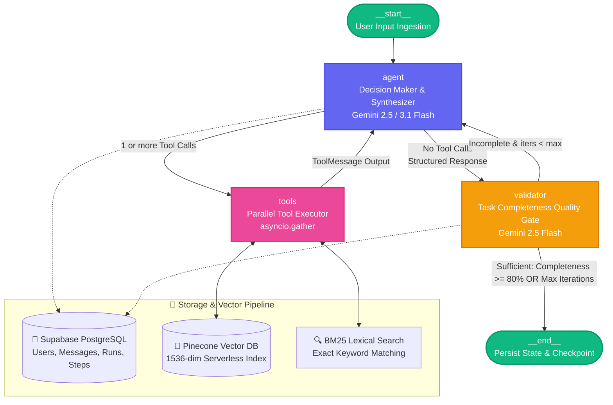

<div align="center">

# ⚡ AutoFlow
### Autonomous Multi-Agent Chatbot & Real-Time LangGraph Node Visualizer

**A stateful, multi-agent AI system with Google Gemini, hybrid Pinecone RAG, LlamaCloud OCR, parallel tool execution, LangGraph memory checkpointer, and a live topological workflow visualizer.**

<br/>

[](https://python.org)
[](https://fastapi.tiangolo.com)
[](https://langchain-ai.github.io/langgraph/)
[](https://ai.google.dev/)
[](https://pinecone.io)
[](https://supabase.com)
[](https://react.dev)
[](https://www.typescriptlang.org/)
[](https://vitejs.dev/)
[](https://tailwindcss.com/)

<br/>

[🌟 Overview](#-overview) • [🏗️ Architecture Flow](#️-architecture-flow) • [📚 Documentation Hub](#-documentation-hub) • [✨ Key Features](#-key-features) • [🚀 Quickstart](#-quickstart-guide) • [📡 API Reference](#-api-endpoints-summary) • [📂 Project Structure](#-project-structure)

</div>

---

## 🌟 Overview

**AutoFlow** is an advanced AI agent chatbot platform engineered with **LangGraph**, **FastAPI**, **Google Gemini**, **Pinecone**, **Supabase**, and **React + TypeScript**. 

Unlike conventional static chatbots, AutoFlow combines **autonomous multi-agent reasoning** with an interactive **3-panel real-time operational interface**:

1. **Left Panel (Chat Sessions & Document Vault)**: 
   - Multi-session thread management with persistent Supabase history.
   - Interactive document selector for targeted multi-file Document RAG.
   - Custom dynamic tool enablement toggles per session.
2. **Center Panel (Conversation Stream & Rich Media)**:
   - Ultra-low latency token streaming via Server-Sent Events (SSE).
   - Dynamic LaTeX math rendering ($E=mc^2$, $\int f(x)dx$) powered by KaTeX.
   - Syntax-highlighted code blocks with language tags and one-click copy.
   - Collapsible tool execution cards detailing arguments, latency, and outputs.
   - Native multimodal vision support for images attached in chat history.
3. **Right Panel (Live LangGraph Node Visualizer & Trace Telemetry)**:
   - Dynamic topological workflow graph displaying nodes (`START` ➔ `agent` ➔ `tools` ➔ `validator` ➔ `END`).
   - Real-time pulse animations illuminating the active node during execution.
   - Chronological step-by-step execution trace log with payload inspects and millisecond timers.

---

## 🏗️ Architecture Flow



---

## 📚 Documentation Hub

Explore the in-depth technical documentation covering every tier of the AutoFlow architecture:

| Document | Focus & Highlights | Direct Link |
| :--- | :--- | :---: |
| 🏛️ **System Architecture** | Decoupled presentation, API gateway, LangGraph execution engine, sequence diagrams, and real-time visualizer data flow. | [Read Docs ➔](docs/architecture.md) |
| 🔄 **Agents Flow & Reasoning** | `AgentState` schema, unified decision + synthesizer pattern, `asyncio.gather` parallel tools, and the 80% completeness validator gate. | [Read Docs ➔](docs/agents-flow.md) |
| 📡 **Full API Reference** | REST endpoints, Server-Sent Events (SSE) event protocol, request/response schemas, Supabase JWT auth, and RBAC tiers. | [Read Docs ➔](docs/apis.md) |
| 💾 **Database & Supabase** | PostgreSQL schema, full Entity-Relationship Diagram (ERD), table definitions, Row-Level Security (RLS) policies, and migrations. | [Read Docs ➔](docs/database.md) |
| 🌲 **Vector DB & Hybrid RAG** | Pinecone Serverless setup, Gemini `models/gemini-embedding-2`, BM25 lexical ranking, Reciprocal Rank Fusion (RRF), and safe 32KB chunking. | [Read Docs ➔](docs/vectordb.md) |
| ⚙️ **Configuration & Setup** | Comprehensive `.env` variables reference, API key provisioning walkthroughs, runtime presets, and troubleshooting runbook. | [Read Docs ➔](docs/configuration.md) |
| 🚀 **Production Deployment** | Cloud deployment runbook for **Render** (FastAPI backend) and **Vercel** (React frontend). | [Read Docs ➔](DEPLOYMENT_GUIDE.md) |

---

## ✨ Key Features

- 🧠 **LangGraph Cyclical State Machine**: Stateful graph execution with conditional branch routing and automated task completeness loops.
- ⚡ **Parallel Tool Dispatcher**: Executes up to 6 tools concurrently via Python's `asyncio.gather()` in milliseconds.
- 🛡️ **Task Completeness Quality Gate**: Dedicated validator evaluating whether the assistant answered $\ge 80\%$ of multi-part user requests before terminating.
- 🌲 **Hybrid Document RAG**: Fuses Pinecone dense vector search with BM25 lexical ranking using Reciprocal Rank Fusion (RRF) and Cross-Encoder reranking.
- 🦙 **LlamaCloud OCR Engine**: Dual parsing modes (**Fast** for simple PDFs; **Agentic** for complex multi-column documents with tables, charts, and diagrams).
- 💾 **Dual-Tier Memory**: In-memory `MemorySaver` thread checkpointer paired with an autonomous Gemini summarizer to condense long-running chat sessions without context loss.
- 📊 **Multi-Format Document Exporters**: Generate and download formatted **PDFs** (with justified typography and tables), **Excel** spreadsheets, **Word** (.docx) files, and **TXT** transcripts.
- 🔐 **Enterprise RBAC & Quotas**: Four user tiers (**Pleasant**, **Jack**, **King**, **Ace**) with daily message quotas, document storage limits, and an Ace Super Admin Dashboard.
- 🎨 **Visual Node Visualizer**: Live topological diagram illuminating executing nodes, tracking execution latencies, and logging full payload telemetry.

---

## 🛠️ Registered Tool Ecosystem

| Tool Name | Engine / Library | Capability Description |
| :--- | :--- | :--- |
| **`retrieve_document_context`** | Pinecone + BM25 + Gemini | Grounded evidence retrieval from user-selected PDFs and DOCX files. |
| **`web_search`** | Tavily AI Search | Real-time web search delivering direct answer summaries and cited sources. |
| **`web_scrape`** | Firecrawl | Full clean Markdown scraping from any specified URL or online PDF link. |
| **`calculate`** | Safe Python AST | Secure mathematical evaluator supporting arithmetic, trigonometry, logs, and roots. |
| **`get_current_time`** | IANA Timezone Engine | Real-time date, time, and timezone resolution. |
| **`export_chat_pdf`** | ReportLab | Generates beautifully styled PDF documents on demand. |
| **`export_chat_excel`** | OpenPyXL | Generates formatted Excel spreadsheets with styled headers and zebra rows. |
| **`export_chat_docx`** | python-docx | Generates structured Microsoft Word documents with headings and tables. |
| **`export_chat_txt`** | Native Python | Generates clean text transcript files. |
| **`process_image`** | Multimodal Vision | Specialized image OCR and analysis tool. |

---

## 🚀 Quickstart Guide

### 1. Prerequisites
- **Python 3.12+**
- **Node.js 18+** & **npm**
- **Google Gemini API Key** (from [Google AI Studio](https://aistudio.google.com/))
- **Supabase Account** (from [Supabase](https://supabase.com/))
- **Pinecone Account** (from [Pinecone](https://pinecone.io/))
- **Tavily API Key** (from [Tavily](https://tavily.com/))
- **LlamaCloud API Key** (from [LlamaCloud](https://cloud.llamaindex.ai/))

### 2. Clone the Repository
```bash
git clone https://github.com/anish2105/AutoFlow_V1.git
cd AutoFlow_V1
```

### 3. Configure Environment Variables
Duplicate the example environment file and populate your keys:
```bash
cp .env.example .env
```
Key environment variables in `.env`:
```env
# Gemini AI
GEMINI_API_KEY=AIzaSy...
GEMINI_MODEL=gemini-2.5-flash
GEMINI_TEMPERATURE=0.7
VALIDATOR_MODEL=gemini-2.5-flash

# Search & OCR
TAVILY_API_KEY=tvly-...
LLAMA_CLOUD_API_KEY=llx-...
FIRECRAWL_API_KEY=fc-...

# Supabase PostgreSQL & Auth
SUPABASE_URL=https://your-project.supabase.co
SUPABASE_SERVICE_ROLE_KEY=your_service_role_key
SUPABASE_JWT_SECRET=your_jwt_secret

# Pinecone Hybrid Vector Store
PINECONE_API_KEY=your_pinecone_key
PINECONE_INDEX_NAME=autoflow-docs
EMBEDDING_MODEL=models/gemini-embedding-2
EMBEDDING_DIMENSION=1536
```
*(For step-by-step instructions for each provider, refer to [Configuration & Setup Guide](docs/configuration.md))*

### 4. Apply Database Migrations
Open your **Supabase Project Dashboard** $\rightarrow$ **SQL Editor**, and run the migration scripts located in `supabase/migrations/` in sequence:
- `001_initial_schema.sql`
- `002_chat_exports.sql`
- `003_user_documents.sql`
- `004_document_content_hash.sql`
- `005_user_roles_and_quotas.sql`
- `006_user_workflows.sql`

### 5. Install Dependencies & Build Frontend
```bash
# Install Python dependencies
pip install -r requirements.txt

# Install frontend dependencies and build production assets
cd frontend
npm install
npm run build
cd ..
```

### 6. Run the Application
```bash
python main.py
```
Open **[http://localhost:8000](http://localhost:8000)** in your browser.

---

## 🛠️ Development Mode (Hot Reload)

For active frontend and backend development with instant hot reloading:

```bash
# Terminal 1: Backend API (Uvicorn Hot Reload)
uvicorn main:app --reload --port 8000

# Terminal 2: Frontend (Vite Dev Server)
cd frontend
npm run dev
```
Open **[http://localhost:5173](http://localhost:5173)** (Vite proxies all `/api` calls directly to port 8000).

---

## 📡 API Endpoints Summary

| Method | Endpoint | Description |
| :--- | :--- | :--- |
| `POST` | `/api/chat/stream` | Server-Sent Events (SSE) streaming tokens, tool events, and node state transitions. |
| `POST` | `/api/chat/invoke` | Synchronous REST invocation returning complete state and steps. |
| `GET` | `/api/chat/conversations` | Lists persistent conversation sessions for the authenticated user. |
| `POST` | `/api/documents/upload` | Ingests PDFs/images via LlamaCloud OCR and indexes embeddings to Pinecone. |
| `GET` | `/api/documents` | Lists digitized documents and vector indexing statuses. |
| `POST` | `/api/exports/generate` | Generates downloadable PDF, Excel, Word, or TXT chat transcripts. |
| `GET` | `/api/graph/schema` | Returns nodes, edges, styling, and tool schemas for visual UI rendering. |
| `GET` | `/api/user/profile` | Returns current user profile, subscription tier, and daily quota meters. |
| `GET` | `/api/admin/metrics` | Super Admin dashboard metrics (users, runs, tool volume, latencies). |
| `GET` | `/docs` | Interactive Swagger / OpenAPI documentation UI. |

*(For full endpoint parameters, request/response schemas, and SSE contracts, see [API Reference](docs/apis.md))*

---

## 💻 Tech Stack

| Category | Technologies |
| :--- | :--- |
| **Agent Orchestration** | LangGraph 0.2+, LangChain Core, LangChain Google GenAI |
| **Large Language Models** | Google Gemini 2.5 Flash, Gemini 3.1 Flash-Lite, Gemini Embedding 2 |
| **Backend Framework** | FastAPI 0.115+, Uvicorn, Pydantic v2, Python 3.12+ |
| **Relational Database** | Supabase PostgreSQL, Row-Level Security (RLS), Supabase Auth |
| **Vector Database & RAG**| Pinecone Serverless, BM25 (rank-bm25), Reciprocal Rank Fusion |
| **Document OCR** | LlamaCloud Fast & Agentic Parsing |
| **Web Research** | Tavily AI Search, Firecrawl Scraper |
| **Frontend Framework** | React 18, TypeScript 5.6, Vite 6, TailwindCSS |
| **Markdown & Math** | react-markdown, remark-math, rehype-katex, PrismJS |
| **Observability** | Langfuse Tracing, Custom RAG Terminal Logger |

---

## 📂 Project Structure

```
AutoFlow_V1/
├── config.py                 # Central Pydantic settings loading .env
├── main.py                   # FastAPI application entrypoint & static SPA serving
├── requirements.txt          # Python dependencies
├── .env.example              # Environment variables template
├── README.md                 # Project README and quickstart guide
│
├── docs/                     # 📚 Comprehensive Documentation Hub
│   ├── architecture.md       # Full system architecture & sequence diagrams
│   ├── agents-flow.md        # LangGraph state machine & reasoning loop
│   ├── apis.md               # Complete REST & SSE API specification
│   ├── database.md           # Supabase PostgreSQL schema, ERD & RLS
│   ├── vectordb.md           # Pinecone hybrid search, BM25 & chunking
│   └── configuration.md      # Configuration guide & API key walkthroughs
│
├── agent/                    # 🧠 LangGraph State Graph & Nodes
│   ├── state.py              # AgentState TypedDict & message extractors
│   └── chatbot_graph.py      # StateGraph with checkpointer & validator gate
│
├── tools/                    # 🛠️ Registered Agent Tools
│   ├── rag_retrieval_tool.py # Pinecone + BM25 Hybrid Document Search
│   ├── web_search.py         # Tavily live internet search
│   ├── web_scrape.py         # Firecrawl web page & online PDF scraper
│   ├── calculator.py         # Safe Python AST math evaluator
│   ├── time_tool.py          # Real-time IANA timezone clock resolver
│   ├── pdf_exporter.py       # Styled ReportLab PDF document generator
│   ├── excel_exporter.py     # OpenPyXL spreadsheet exporter
│   ├── docx_exporter.py      # python-docx Microsoft Word exporter
│   └── txt_exporter.py       # Plain text transcript exporter
│
├── services/                 # ⚙️ Core Application Services
│   ├── rag_service.py        # Pinecone vector indexing & RRF hybrid retrieval
│   ├── llama_ocr_service.py  # LlamaCloud Fast & Agentic OCR parsing
│   ├── docx_service.py       # Word document parsing & formatting
│   └── langfuse_service.py   # Telemetry & trace evaluation
│
├── routers/                  # 📡 FastAPI Routers
│   ├── chat.py               # SSE streaming & conversation management
│   ├── documents.py          # Document upload, OCR & Pinecone indexing
│   ├── export.py             # Export generation & binary downloads
│   ├── graph.py              # Node topology schema & server config
│   ├── user.py               # User profile, quotas & tool toggles
│   ├── workflows.py          # Custom user workflows & canvas telemetry
│   └── admin.py              # Ace Super Admin metrics & tier promotions
│
├── auth/                     # 🔐 Authentication & RBAC
│   ├── supabase_auth.py      # Supabase JWT token validation middleware
│   └── rbac.py               # Tier permissions (Pleasant, Jack, King, Ace)
│
├── db/                       # 💾 Database Repositories
│   ├── chat_repository.py    # Conversations, messages, and runs CRUD
│   ├── document_repository.py# User documents & parsed pages CRUD
│   ├── tier_repository.py    # Quota meters & upgrade requests
│   └── workflow_repository.py# Custom workflows persistence
│
├── supabase/                 # 🐘 Supabase Database Migrations
│   └── migrations/           # 001_initial_schema.sql to 006_user_workflows.sql
│
└── frontend/                 # 🖥️ React 18 + TypeScript + Vite 6 UI
    ├── src/
    │   ├── App.tsx           # 3-pane layout & state coordinator
    │   ├── components/
    │   │   ├── Header.tsx    # Model pill & system status indicator
    │   │   ├── Sidebar/      # Chat history, document selector, tool toggles
    │   │   ├── Chat/         # ChatPanel, MessageItem, ToolCard, InputBox
    │   │   └── Graph/        # GraphPanel, GraphCanvas, TraceTimeline
    │   ├── services/api.ts   # SSE streaming & REST API client
    │   └── types/index.ts    # TypeScript definitions
    └── dist/                 # Production-built web bundle
```

---

## 📄 License

This project is licensed under the [MIT License](LICENSE).

<div align="center">
  <b>Built with ❤️ by <a href="https://github.com/anish2105">Anish Vantagodi</a></b>
</div>
