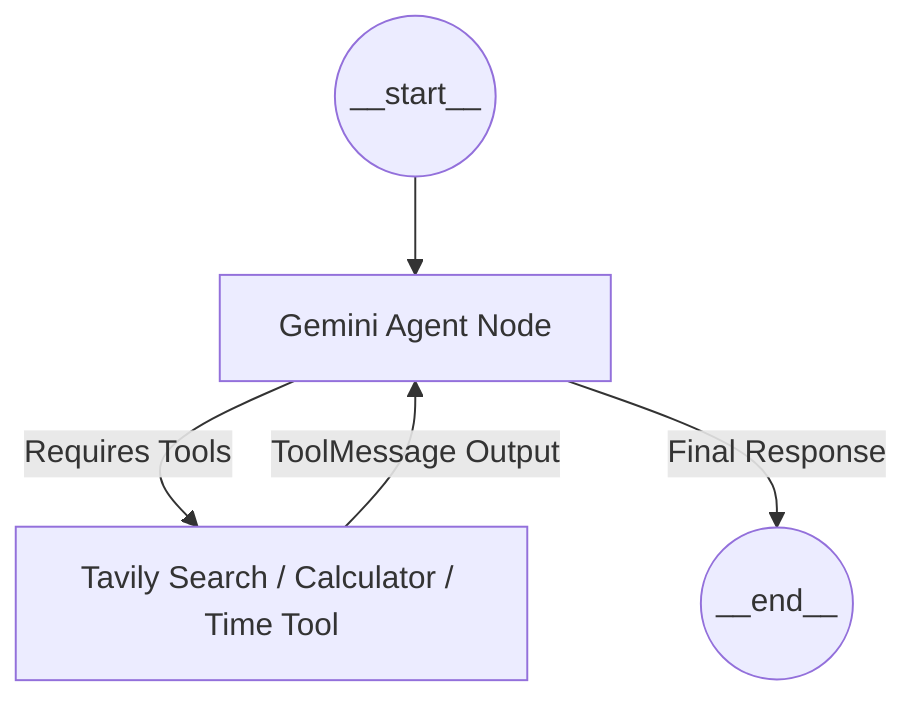

<div align="center">

# ⚡ AutoFlow • LangGraph Chatbot & Live Node Visualizer

**A stateful, multi-turn AI chatbot with Google Gemini, dynamic tool execution, LangGraph memory checkpointer, and a real-time visual workflow diagram.**

[](https://python.org)
[](https://fastapi.tiangolo.com)
[](https://langchain-ai.github.io/langgraph/)
[](https://ai.google.dev/)
[](https://react.dev)
[](https://www.typescriptlang.org/)
[](https://vitejs.dev/)

</div>

---

## 🌟 Overview

**AutoFlow** is an AI agent chatbot application built with **LangGraph**, **FastAPI**, **Google Gemini**, and **React + TypeScript**.

Unlike static chat interfaces, AutoFlow provides a **real-time visual experience**:
- **Left Panel (Chat Sessions & Conversation Stream)**: Full conversational AI with memory persistence, token-by-token streaming, KaTeX math rendering, syntax-highlighted code blocks with one-click copy, and Markdown tables.
- **Right Panel (Live LangGraph Node Visualizer)**: Live topological diagram highlighting which node is executing in real-time (`START` ➔ `agent_node` ➔ `tools_node` ➔ `END`), accompanied by a granular execution trace log with latency and payload inspects.

---

## 🏗️ Architecture Flow



---

## ✨ Key Features

- 🧠 **LangGraph StateGraph Workflow**: Declarative cycle management with conditional routing between agent reasoning and tool execution.
- 💾 **Memory Checkpointer (`MemorySaver`)**: Stateful multi-turn conversation memory keyed by unique `thread_id`s.
- 📂 **Multi-Session Chat Manager**: Create, switch, and delete multiple conversation threads with local storage and server checkpointer synchronization.
- 🔍 **Tavily AI Search Tool**: Live internet research delivering direct AI answer summaries and cited sources with relevance scores.
- 🧮 **Safe AST Math Calculator**: Evaluates arithmetic and complex functions (`sqrt`, `sin`, `log`, `exp`, `pow`) securely without arbitrary code execution vulnerabilities.
- ⏰ **Global Timezone Resolver**: Formatted real-time date/time lookups for any IANA timezone.
- 🎨 **Rich Markdown & LaTeX Math**:
  - Code syntax blocks with language tags and copy-code buttons.
  - LaTeX math formulas ($E = mc^2$, $\int f(x) dx$) powered by `remark-math` and `rehype-katex`.
  - Dark glassmorphism tables with responsive zebra styling.
- 📡 **Server-Sent Events (SSE)**: Low-latency streaming of token deltas, tool lifecycle events (`tool_start`, `tool_end`), and node transitions (`node_start`, `node_end`).

---

## 📚 Documentation
* 🚀 [Render & Vercel Production Deployment Guide (DEPLOYMENT_GUIDE.md)](file:///d:/Projects/LLM/AutoFlow_V1/DEPLOYMENT_GUIDE.md)
* 📖 [Full API Reference & Specifications (API_DOCUMENTATION.md)](file:///d:/Projects/LLM/AutoFlow_V1/API_DOCUMENTATION.md)
* 📐 [Architecture & System Design (DOCUMENTATION.md)](file:///d:/Projects/LLM/AutoFlow_V1/DOCUMENTATION.md)
* 🎨 [UI & Visual Design Specs (UI_DESIGN_SPEC.md)](file:///d:/Projects/LLM/AutoFlow_V1/UI_DESIGN_SPEC.md)

---

## 📂 Project Structure

```
AutoFlow_V1/
├── config.py                 # Central configuration importing .env via Pydantic
├── requirements.txt          # Python dependencies
├── .env.example              # Sample environment template
├── main.py                   # FastAPI server entrypoint (serves API & static UI)
├── README.md                 # Project overview and quickstart guide
├── DOCUMENTATION.md          # In-depth technical architecture manual
│
├── llm/                      # LLM Provider Abstractions
│   ├── __init__.py
│   └── gemini.py             # Gemini LLM initialization & tool binding
│
├── agent/                    # LangGraph Assembly & State
│   ├── __init__.py
│   ├── state.py              # AgentState TypedDict & text extractors
│   └── chatbot_graph.py      # StateGraph with Memory Checkpointer
│
├── tools/                    # Registered LangGraph Tools
│   ├── __init__.py           # Central tool registry
│   ├── calculator.py         # Safe AST math evaluator
│   ├── web_search.py         # Tavily live search with AI summary & sources
│   └── time_tool.py          # Real-time timezone and clock resolver
│
├── routers/                  # FastAPI REST & SSE Streaming Routers
│   ├── __init__.py
│   ├── chat.py               # SSE `/api/chat/stream` & checkpointer endpoints
│   └── graph.py              # Schema `/api/graph/schema` & config
│
└── frontend/                 # React 18 + TypeScript + Vite UI
    ├── src/
    │   ├── App.tsx           # 3-pane layout orchestration & session manager
    │   ├── index.css         # Dark theme, glassmorphism & glowing animations
    │   ├── components/
    │   │   ├── Header.tsx            # Model pill & active node state
    │   │   ├── Sidebar/ChatSidebar   # Left conversation menu & "+ New Chat"
    │   │   ├── Chat/                 # ChatPanel, MessageItem, ToolCard, ChatInput
    │   │   └── Graph/                # GraphPanel, GraphCanvas, TraceTimeline
    │   ├── services/api.ts   # SSE streaming & thread API client
    │   └── types/index.ts    # TypeScript definitions
    └── dist/                 # Production-built bundle
```

---

## 🚀 Quickstart Guide

### 1. Prerequisites
- **Python 3.12+**
- **Node.js 18+** & **npm**
- **Google Gemini API Key** (from [Google AI Studio](https://aistudio.google.com/))
- **Tavily API Key** (from [Tavily](https://tavily.com/))

### 2. Setup Environment Variables
Create a `.env` file in the project root:

```bash
# Gemini Settings
GEMINI_API_KEY=AIzaSy...
GEMINI_MODEL=gemini-2.5-flash
GEMINI_TEMPERATURE=0.7

# Tavily Search Key
TAVILY_API_KEY=tvly-...

# Server Settings
HOST=0.0.0.0
PORT=8000
DEBUG=True
```

### 3. Install Python Dependencies
```bash
pip install -r requirements.txt
```

### 4. Build the Frontend
```bash
cd frontend
npm install
npm run build
cd ..
```

### 5. Start the Server
```bash
python main.py
```
Open **[http://localhost:8000](http://localhost:8000)** in your browser.

---

## 🛠️ Development Mode (Hot Reload)

To run both backend and frontend with live hot reloading:

```bash
# Terminal 1: Backend
uvicorn main:app --reload --port 8000

# Terminal 2: Frontend
cd frontend
npm run dev
```
Open **[http://localhost:5173](http://localhost:5173)** (Vite proxies `/api` calls to port 8000).

---

## 📡 API Reference

| Method | Endpoint | Description |
| :--- | :--- | :--- |
| `POST` | `/api/chat/stream` | Server-Sent Events (SSE) streaming tokens, node events, and tool outputs with checkpointer thread memory. |
| `POST` | `/api/chat/invoke` | Synchronous REST invocation returning complete state. |
| `GET` | `/api/chat/threads/{thread_id}/history` | Retrieves conversation history from the checkpointer. |
| `DELETE` | `/api/chat/threads/{thread_id}` | Clears conversation memory for a thread. |
| `GET` | `/api/graph/schema` | Returns nodes, edges, tool metadata, and model specs for UI rendering. |
| `GET` | `/api/graph/config` | Returns runtime server configuration and model info. |
| `GET` | `/docs` | Interactive Swagger API documentation. |

---

## 📄 Documentation

For an in-depth architectural breakdown, state graph lifecycles, and customization instructions, see **[DOCUMENTATION.md](DOCUMENTATION.md)**.
