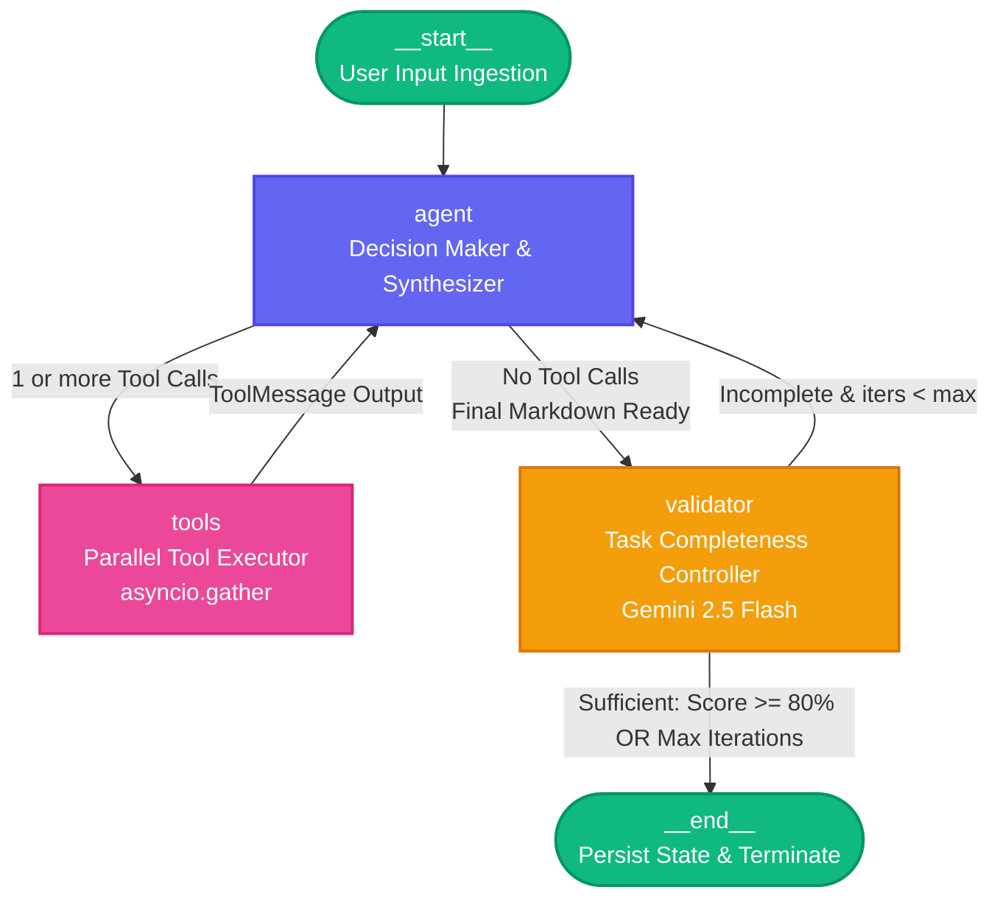
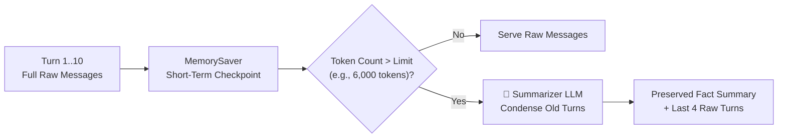

# 🔄 AutoFlow Agents Flow & Reasoning Lifecycle

Comprehensive technical specification of the **AutoFlow LangGraph State Machine**, **Agent Decision & Synthesis Loop**, **Parallel Tool Dispatcher**, **Task Completeness Quality Gate**, and **Dynamic Conversation Summarizer**.

---

## 1. Graph State Model (`AgentState`)

AutoFlow manages state throughout multi-turn conversations using a strongly typed `AgentState` schema defined in `agent/state.py`.

```python
class AgentState(TypedDict):
    # 1. Conversation turns with LangGraph message reducer
    messages: Annotated[Sequence[BaseMessage], add_messages]
    
    # 2. Node & workflow tracking
    current_node: str
    status: str
    
    # 3. Research goal & accumulated evidence
    research_goal: Optional[str]
    evidence: List[Dict[str, Any]]
    
    # 4. Tool execution details
    last_tool_call: Optional[Dict[str, Any]]
    tool_results: List[Dict[str, Any]]
    
    # 5. Validation gate
    validation: ValidationResult
    
    # 6. Safety & loop bounds
    iteration_count: int
    max_iterations: int
    
    # 7. Step-by-step trace log with operator.add reducer
    execution_steps: Annotated[List[ExecutionStep], operator.add]

    # 8. Persistent conversation summary & condensation tracking
    summary: Optional[str]
    summarized_message_count: Optional[int]

    # 9. Dynamic tool enablement (filtered by user toggle preferences)
    enabled_tools: Optional[List[str]]

    # 10. Trusted Document RAG context (injected from chat state)
    selected_file_ids: Optional[List[str]]
    retrieved_chunks: Optional[List[Dict[str, Any]]]
```

### State Reducer Mechanics:
- **`add_messages`**: Automatically merges new `HumanMessage`, `AIMessage`, and `ToolMessage` instances while preserving previous turns and tool call associations.
- **`operator.add` for `execution_steps`**: Appends step-by-step telemetry objects (`ExecutionStep`) without overwriting previous steps, enabling a complete chronological audit trail.

---

## 2. LangGraph State Machine Topology

AutoFlow operates as a cyclical directed graph with unified decision-making, parallel tool execution, and an automated task completeness quality gate.



### Transition Logic:

```python
def should_continue_agent(state: AgentState) -> Literal["tools", "validator"]:
    """Routing from Agent: if tool calls are present -> tools, else -> validator."""
    messages = state.get("messages", [])
    last_message = messages[-1] if messages else None

    if last_message and getattr(last_message, "tool_calls", None):
        return "tools"
    return "validator"


def should_continue_validator(state: AgentState) -> Literal["agent", "__end__"]:
    """Routing from Validator: if complete (>= 80% completeness) -> __end__, else -> agent."""
    validation = state.get("validation", {})
    iteration = state.get("iteration_count", 1)
    max_iters = state.get("max_iterations", 5)

    completeness = float(validation.get("completeness_score", 100.0 if validation.get("sufficient", False) else 0.0))
    is_sufficient = bool(validation.get("sufficient", False)) or (completeness >= 80.0)

    # 1. Complete -> Finished
    if is_sufficient:
        return "__end__"

    # 2. Safety cutoff: Allow up to 3 refinement iterations
    if iteration >= 3 or iteration >= max_iters:
        return "__end__"

    # 3. Incomplete (< 80%) -> Loop back to agent with critique
    return "agent"
```

---

## 3. Node Execution Deep Dive

### 3.1 `agent` Node (Decision Maker + Synthesizer)
The `agent` node is the primary cognitive engine powered by **Google Gemini** (`gemini-2.5-flash` or `gemini-3.1-flash-lite`).

#### Responsibilities:
1. **Dynamic Tool Injection**: Inspects the user's active tool preferences (`enabled_tools`) and dynamically constructs a customized system prompt so the LLM never hallucinates calls to disabled tools.
2. **Context Assembly**:
   - Re-injects the **Condensed Long-Term Summary** (if conversation exceeds sliding window limits).
   - Injects authorized document context (`selected_file_ids`).
   - Appends multimodal images directly for native vision inspection.
3. **Dual Execution Modes**:
   - **Mode A (Tool Needed)**: Emits one or more parallel tool calls (e.g. `retrieve_document_context`, `web_search`, `calculate`).
   - **Mode B (Synthesis)**: If tool results are present or no tools are needed, immediately synthesizes a structured Markdown response with LaTeX equations, tables, and citations.

---

### 3.2 `tools` Node (Parallel Tool Executor)
When the LLM requests external actions, the `tools` node executes all requested tools **concurrently** rather than sequentially:

```python
# Maximum parallel tools allowed per turn
MAX_PARALLEL_TOOLS_PER_TURN = 6

async def parallel_tools_node(state: AgentState) -> Dict[str, Any]:
    last_message = state["messages"][-1]
    tool_calls = getattr(last_message, "tool_calls", [])[:MAX_PARALLEL_TOOLS_PER_TURN]
    
    # Concurrently execute tools via asyncio.gather
    results = await asyncio.gather(*[
        execute_single_tool(tc) for tc in tool_calls
    ], return_exceptions=True)
    
    # Construct ToolMessage instances and append to state
    tool_messages = [
        ToolMessage(content=str(res), tool_call_id=tc["id"], name=tc["name"])
        for tc, res in zip(tool_calls, results)
    ]
    return {"messages": tool_messages}
```

#### Available Registered Tools:
1. **`retrieve_document_context`**: Hybrid vector + lexical search across user-selected uploaded PDFs/DOCX files.
2. **`web_search`**: Live Tavily AI internet search with direct summaries and cited source links.
3. **`web_scrape`**: Firecrawl markdown extraction from any specified URL or online PDF link.
4. **`calculate`**: Safe AST mathematical evaluation (arithmetic, trigonometry, logarithms, powers).
5. **`get_current_time`**: Real-time IANA timezone resolver and clock lookups.
6. **`export_chat_pdf`**: On-the-fly PDF document generation with styled tables and headers.
7. **`export_chat_excel`**: Excel spreadsheet creation with zebra styling and auto-fitting columns.
8. **`export_chat_docx`**: Microsoft Word (.docx) generator with styled typography.
9. **`export_chat_txt`**: Raw formatted text dump generator.
10. **`process_image`**: Specialized image OCR/analysis utility.

---

### 3.3 `validator` Node (Task Completeness Quality Gate)
The `validator` node uses a dedicated low-temperature Gemini model (`gemini-2.5-flash` at `temperature=0.1`) to evaluate the assistant's generated output against the user's original multi-part query.

#### The 80% Completeness Threshold Rule:
- Calculates a quantitative `completeness_score` from $0$ to $100$.
- If `completeness_score >= 80`, the response is accepted and routed to `__end__`.
- If `completeness_score < 80`, it generates a list of `missing_information` and an actionable `critique`, routing back to the `agent` node for targeted refinement.
- **Safety Boundary**: The graph caps refinement loops at a maximum of 3 iterations to prevent infinite recursion and quota exhaustion.

#### Validator Output JSON Schema:
```json
{
  "completeness_score": 92.5,
  "sufficient": true,
  "confidence": 0.95,
  "missing_information": [],
  "issues": [],
  "critique": "All 3 comparison points and the mathematical formula were thoroughly addressed."
}
```

---

## 4. Conversation Memory & Dynamic Summarization

To support multi-hour and multi-day conversations without breaching LLM context windows or incurring token explosion, AutoFlow implements a **Two-Tier Memory Model**:



### Context Condensation Rules:
1. **Preserve User Intent & Motive**: Retains high-level objectives and user goals.
2. **Preserve Entities & Names**: Safeguards project names, file names, URLs, and identities.
3. **Preserve Dates & Milestones**: Maintains deadlines, timestamps, and schedules.
4. **Preserve Definitive Decisions**: Retains confirmed formulas, code configurations, and numerical results.
5. **Cumulative Summarization**: Successive summarization cycles roll older summaries into the new summary without dropping historical context.

---

## 5. Multimodal Vision Handling

AutoFlow natively processes user-attached images through Gemini's native vision encoder:
- Images uploaded by the user are encoded as base64 data URLs or binary buffers and injected into `HumanMessage.content` as image parts.
- The `agent` node inspects diagrams, schematics, screenshots, and visual tables directly without requiring external OCR tools.
- Specialized document OCR for complex multi-page PDFs is handled upstream by the **LlamaCloud OCR Service**.

---

## 6. Next Steps & Related Documentation
* 🏛️ **[System Architecture & Design](architecture.md)**: High-level topology and component diagrams.
* 📡 **[Full API Reference](apis.md)**: Endpoints, SSE streaming contracts, and schemas.
* 💾 **[Database Architecture](database.md)**: PostgreSQL schemas, tables, and Supabase RLS.
* 🌲 **[Vector DB & Hybrid RAG](vectordb.md)**: Pinecone indexing, BM25, and chunking algorithms.
* ⚙️ **[Configuration & Setup Guide](configuration.md)**: Environment keys, models, and setup runbook.
