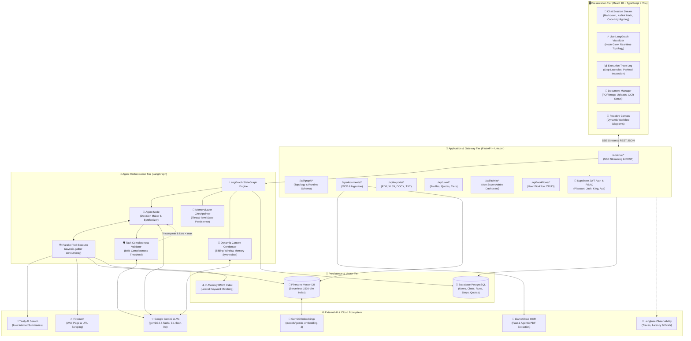
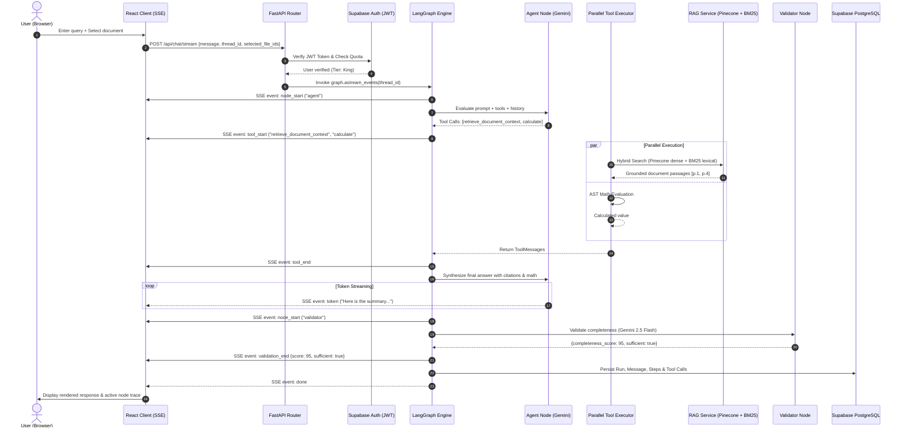

# 🏛️ AutoFlow System Architecture

Comprehensive architectural specifications and system design for **AutoFlow** — an autonomous multi-agent chatbot and real-time execution visualizer powered by **LangGraph**, **Google Gemini**, **FastAPI**, **Supabase PostgreSQL**, **Pinecone Vector DB**, and **React + TypeScript**.

---

## 1. High-Level System Architecture

AutoFlow decouples real-time presentation, asynchronous agent orchestration, high-speed hybrid retrieval, and transactional persistence into a clean, modular multi-tier architecture.

---

## 2. Core Architectural Subsystems

### 2.1 Presentation Tier (`frontend/`)
The frontend is built using **React 18**, **TypeScript 5.6**, **Vite 6**, and modern **TailwindCSS** with dark glassmorphism styling:
- **Three-Panel Unified Layout**:
  - **Left Drawer**: Conversation history, thread switching, new session creation, active document selector, and tool toggles.
  - **Center Viewport**: High-performance streaming chat interface supporting LaTeX math ($...$ and $$...$$) via `remark-math` and `rehype-katex`, syntax-highlighted code blocks with language pills and copy buttons, GFM tables, and collapsible tool execution cards.
  - **Right Sidebar**: Real-time topological LangGraph visualizer displaying the active executing node (`agent`, `tools`, `validator`), live millisecond execution timers, and deep payload trace inspects.
- **Server-Sent Events (SSE) Client**: Robust event-stream consumer handling low-latency token deltas, tool lifecycle events, validation scores, and graph state updates without polling.

---

### 2.2 Application & Gateway Tier (`routers/`, `main.py`)
The backend is driven by **FastAPI 0.115+** running on **Uvicorn**:
- **Modular Routers**:
  - `routers/chat.py`: Handles SSE streaming (`/api/chat/stream`), synchronous invocation (`/api/chat/invoke`), conversation history management, and thread state.
  - `routers/graph.py`: Supplies dynamic node/edge topology (`/api/graph/schema`) and active model settings (`/api/graph/config`).
  - `routers/documents.py`: Ingests PDFs, images, and DOCX files; triggers LlamaCloud OCR; orchestrates chunking and Pinecone vector indexing.
  - `routers/export.py`: Generates on-demand styled PDF, Excel (.xlsx), Word (.docx), and plain text (.txt) exports of conversation threads.
  - `routers/user.py`: Exposes user profile, subscription tier, quota meters, and tool preference updates.
  - `routers/workflows.py`: Manages user custom workflows and canvas logging.
  - `routers/admin.py`: Powers the Ace Super Admin Dashboard with system metrics, user tier promotion/demotion, and custom quota overrides.
- **Authentication & RBAC**: Decodes Supabase JWT tokens via `auth/supabase_auth.py` and validates permissions across four tiers: `pleasant`, `jack`, `king`, and `ace` via `auth/rbac.py`.

---

### 2.3 Agent Orchestration Tier (`agent/`)
Built with **LangGraph 0.2+**:
- **Unified Decision + Synthesizer Pattern**: Rather than separating decision-making and final answer synthesis into separate nodes, a single `agent` node handles both roles with zero extra latency.
- **Async Parallel Tool Execution**: When multiple tools are required (e.g., retrieving document chunks and performing web search), all tool calls are executed concurrently using `asyncio.gather()`, capped at 6 concurrent tools to respect rate limits.
- **Task Completeness Quality Gate**: An autonomous `validator` node evaluates whether the response answers $\ge 80\%$ of multi-part user requests. If deficient, it loops back with structured critique.
- **Dual Memory Layer**:
  - **Short-term Memory**: Managed by LangGraph's `MemorySaver` keyed by `thread_id`.
  - **Long-term Condensed Memory**: A dedicated Gemini summarizer condenses historical turns into structured facts, preserving motives, dates, and entity definitions across hundreds of turns.

---

### 2.4 Hybrid Vector & Storage Tier (`services/rag_service.py`, `supabase/`)
- **Supabase PostgreSQL**: Persistent relational storage for users, threads, messages, execution traces, tool records, and document metadata.
- **Pinecone Serverless Vector Database**: High-dimension vector index (`autoflow-docs`) storing 1536-dimensional embeddings produced by `models/gemini-embedding-2`.
- **Hybrid Search Engine**: Fuses Pinecone dense vector semantic matching with in-memory **BM25** keyword ranking using **Reciprocal Rank Fusion (RRF)** and Cross-Encoder reranking.
- **Safe 32KB Chunking Engine**: Automatically bisects documents and giant markdown tables at line and paragraph boundaries to guarantee that vector metadata never breaches Pinecone's 40KB hard limit.

---

## 3. End-to-End Sequence Diagram

The following sequence diagram illustrates how a user request flows through the entire system during a multi-turn RAG and tool execution lifecycle:

---

## 4. Key Design Decisions & Highlights

| Architectural Area | Decision | Rationale |
| :--- | :--- | :--- |
| **Agent Orchestration** | LangGraph StateGraph | Enables declarative state machines, cyclical looping, deterministic validation gates, and checkpointing. |
| **LLM Provider** | Google Gemini (2.5 Flash / 3.1 Flash-Lite) | Industry-leading 1M+ token context window, multimodal vision support, rapid time-to-first-token (TTFT), and cost efficiency. |
| **Vector Database** | Pinecone Serverless | Zero-maintenance serverless scalability, sub-50ms vector query latencies, and metadata filtering per user and file. |
| **Hybrid Search** | Dense Vector + BM25 + RRF | Resolves the vocabulary mismatch problem: dense vectors capture conceptual intent, while BM25 guarantees exact-match keyword hits. |
| **Document OCR** | LlamaCloud Fast & Agentic Parsing | State-of-the-art layout-aware document extraction turning complex multi-column PDFs, tables, and charts into structured Markdown. |
| **Streaming Protocol** | Server-Sent Events (SSE) | HTTP/2-friendly, native reconnect semantics, lightweight firewall-friendly single-direction event streaming. |
| **Security & Auth** | Supabase Row-Level Security (RLS) | Enforces multi-tenant data isolation at the database kernel level; prevents unauthorized cross-tenant data access. |

---

## 5. Next Steps & Related Documentation
* 🔄 **[Agents Flow & Reasoning Lifecycle](agents-flow.md)**: State machine topology, parallel tool dispatcher, and completeness validator.
* 📡 **[Full API Reference & Specifications](apis.md)**: Comprehensive REST endpoints, request/response schemas, and SSE event contracts.
* 💾 **[Database Architecture & Schema](database.md)**: PostgreSQL entity-relationship diagrams, schema tables, and RLS policies.
* 🌲 **[Vector DB & Hybrid RAG Pipeline](vectordb.md)**: Pinecone indexing, BM25 integration, chunking algorithms, and reranking.
* ⚙️ **[Configuration & Setup Guide](configuration.md)**: Environment variables, API keys, and deployment runbooks.
