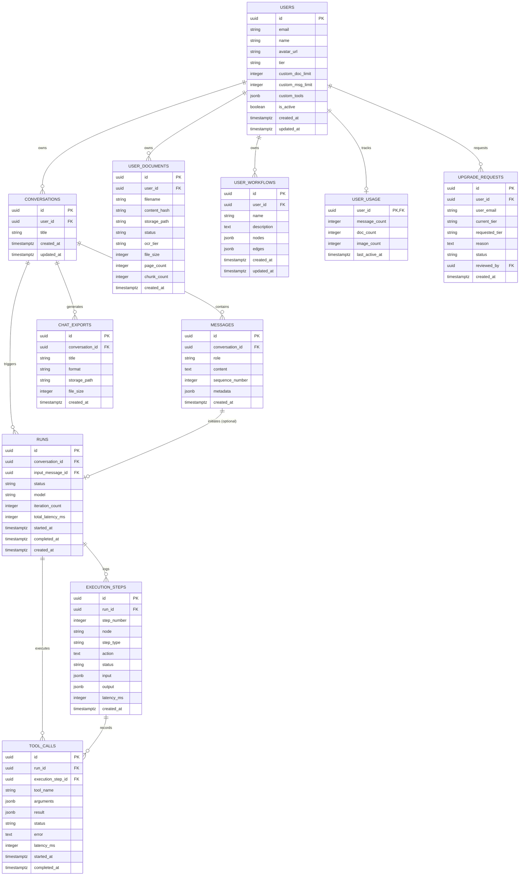

# 💾 AutoFlow Database Architecture & Schema

Comprehensive specifications for **AutoFlow's Supabase PostgreSQL** database engine, entity-relationship models, table definitions, row-level security (RLS) policies, and migrations.

---

## 1. Architectural Overview & Entity Hierarchy

AutoFlow stores conversational data, execution traces, document repositories, user workflows, and quota tiers in a relational schema on PostgreSQL hosted on Supabase:

```
public.users (Public Profiles synced with Supabase auth.users)
├── public.conversations (Persistent Multi-Turn Chat Sessions)
│   ├── public.messages (Chronological User & Assistant Messages)
│   ├── public.runs (Workflow Executions triggered per turn)
│   │   ├── public.execution_steps (LangGraph Node Visits: agent, tools, validator)
│   │   └── public.tool_calls (First-Class Tool Invocations: web_search, calculate, etc.)
│   └── public.chat_exports (Generated PDF, Excel, DOCX, & TXT Exports)
│
├── public.user_documents (Digitized PDFs, Images, DOCX files)
│   └── public.parsed_pages (Structured JSONB page-wise OCR Markdown via LlamaCloud)
│
├── public.user_workflows (Custom User Workflows & Reactive Canvas Schemas)
├── public.user_usage (Message, Document, and Image Quota Meters)
└── public.upgrade_requests (Tier Promotion Review Queue)
```

---

## 2. Complete Entity-Relationship Diagram (ERD)



---

## 3. Detailed Table Schema Definitions

### 3.1 `public.users`
Stores user profile information, role-based tiers, and customized quota allocations. Synchronized automatically with Supabase's `auth.users`.

```sql
CREATE TABLE public.users (
    id UUID PRIMARY KEY REFERENCES auth.users(id) ON DELETE CASCADE,
    email VARCHAR(255) NOT NULL,
    name VARCHAR(255),
    avatar_url TEXT,
    tier VARCHAR(20) NOT NULL DEFAULT 'jack' CHECK (tier IN ('pleasant', 'jack', 'king', 'ace')),
    custom_doc_limit INTEGER DEFAULT NULL,
    custom_msg_limit INTEGER DEFAULT NULL,
    custom_tools JSONB DEFAULT NULL,
    is_active BOOLEAN NOT NULL DEFAULT true,
    created_at TIMESTAMPTZ NOT NULL DEFAULT now(),
    updated_at TIMESTAMPTZ NOT NULL DEFAULT now()
);
```

---

### 3.2 `public.conversations` & `public.messages`
Maintains long-lived conversation sessions and chronological chat transcripts:

```sql
CREATE TABLE public.conversations (
    id UUID PRIMARY KEY DEFAULT gen_random_uuid(),
    user_id UUID NOT NULL REFERENCES public.users(id) ON DELETE CASCADE,
    title VARCHAR(255) NOT NULL DEFAULT 'New Conversation',
    created_at TIMESTAMPTZ NOT NULL DEFAULT now(),
    updated_at TIMESTAMPTZ NOT NULL DEFAULT now()
);

CREATE TABLE public.messages (
    id UUID PRIMARY KEY DEFAULT gen_random_uuid(),
    conversation_id UUID NOT NULL REFERENCES public.conversations(id) ON DELETE CASCADE,
    role VARCHAR(50) NOT NULL CHECK (role IN ('user', 'assistant', 'system')),
    content TEXT NOT NULL,
    sequence_number INTEGER NOT NULL DEFAULT 1,
    metadata JSONB DEFAULT '{}'::jsonb,
    created_at TIMESTAMPTZ NOT NULL DEFAULT now()
);

CREATE INDEX idx_messages_conversation_seq ON public.messages(conversation_id, sequence_number ASC);
```

---

### 3.3 `public.runs`, `public.execution_steps` & `public.tool_calls`
Telemetry and observability layer recording every LangGraph node transition and tool call:

```sql
CREATE TABLE public.runs (
    id UUID PRIMARY KEY DEFAULT gen_random_uuid(),
    conversation_id UUID NOT NULL REFERENCES public.conversations(id) ON DELETE CASCADE,
    input_message_id UUID REFERENCES public.messages(id) ON DELETE SET NULL,
    status VARCHAR(50) NOT NULL DEFAULT 'running' CHECK (status IN ('running', 'completed', 'failed', 'cancelled')),
    model VARCHAR(100) NOT NULL,
    iteration_count INTEGER NOT NULL DEFAULT 1,
    total_latency_ms INTEGER,
    started_at TIMESTAMPTZ NOT NULL DEFAULT now(),
    completed_at TIMESTAMPTZ,
    created_at TIMESTAMPTZ NOT NULL DEFAULT now()
);

CREATE TABLE public.execution_steps (
    id UUID PRIMARY KEY DEFAULT gen_random_uuid(),
    run_id UUID NOT NULL REFERENCES public.runs(id) ON DELETE CASCADE,
    step_number INTEGER NOT NULL,
    node VARCHAR(100) NOT NULL,
    step_type VARCHAR(50) NOT NULL,
    action TEXT,
    status VARCHAR(50) NOT NULL,
    input JSONB,
    output JSONB,
    latency_ms INTEGER,
    created_at TIMESTAMPTZ NOT NULL DEFAULT now()
);

CREATE TABLE public.tool_calls (
    id UUID PRIMARY KEY DEFAULT gen_random_uuid(),
    run_id UUID NOT NULL REFERENCES public.runs(id) ON DELETE CASCADE,
    execution_step_id UUID REFERENCES public.execution_steps(id) ON DELETE SET NULL,
    tool_name VARCHAR(100) NOT NULL,
    arguments JSONB,
    result JSONB,
    status VARCHAR(50) NOT NULL CHECK (status IN ('success', 'failed', 'running')),
    error TEXT,
    latency_ms INTEGER,
    started_at TIMESTAMPTZ NOT NULL DEFAULT now(),
    completed_at TIMESTAMPTZ
);
```

---

### 3.4 `public.user_documents`
Tracks digitized user files, parsing statuses, and content deduplication hashes:

```sql
CREATE TABLE public.user_documents (
    id UUID PRIMARY KEY DEFAULT gen_random_uuid(),
    user_id UUID NOT NULL REFERENCES public.users(id) ON DELETE CASCADE,
    filename VARCHAR(255) NOT NULL,
    content_hash VARCHAR(64),
    storage_path TEXT,
    status VARCHAR(50) NOT NULL DEFAULT 'uploaded' CHECK (status IN ('uploaded', 'processing', 'digitized', 'failed')),
    ocr_tier VARCHAR(20) NOT NULL DEFAULT 'fast' CHECK (ocr_tier IN ('fast', 'agentic')),
    file_size INTEGER NOT NULL DEFAULT 0,
    page_count INTEGER NOT NULL DEFAULT 0,
    chunk_count INTEGER NOT NULL DEFAULT 0,
    parsed_pages JSONB DEFAULT '[]'::jsonb,
    error_message TEXT,
    created_at TIMESTAMPTZ NOT NULL DEFAULT now(),
    updated_at TIMESTAMPTZ NOT NULL DEFAULT now()
);

CREATE INDEX idx_user_documents_user_id ON public.user_documents(user_id);
CREATE INDEX idx_user_documents_hash ON public.user_documents(user_id, content_hash);
```

---

## 4. Row-Level Security (RLS) & Multi-Tenant Isolation

Supabase PostgreSQL Row-Level Security guarantees that authenticated users can only query and mutate their own data:

```sql
-- Enable RLS on core tables
ALTER TABLE public.conversations ENABLE ROW LEVEL SECURITY;
ALTER TABLE public.messages ENABLE ROW LEVEL SECURITY;
ALTER TABLE public.user_documents ENABLE ROW LEVEL SECURITY;
ALTER TABLE public.chat_exports ENABLE ROW LEVEL SECURITY;
ALTER TABLE public.user_workflows ENABLE ROW LEVEL SECURITY;

-- Conversations Policy
CREATE POLICY "Users access own conversations"
ON public.conversations FOR ALL TO authenticated
USING (auth.uid() = user_id);

-- Messages Policy (via conversation ownership)
CREATE POLICY "Users access own messages"
ON public.messages FOR ALL TO authenticated
USING (
    conversation_id IN (
        SELECT id FROM public.conversations WHERE user_id = auth.uid()
    )
);

-- Documents Policy
CREATE POLICY "Users access own documents"
ON public.user_documents FOR ALL TO authenticated
USING (auth.uid() = user_id);
```

---

## 5. Database Migrations History

All schema changes are versioned and stored in `supabase/migrations/`:

| Migration File | Version | Summary of Changes |
| :--- | :--- | :--- |
| `001_initial_schema.sql` | `1.0.0` | Initial tables: `users`, `conversations`, `messages`, `runs`, `execution_steps`, `tool_calls`. |
| `002_chat_exports.sql` | `1.1.0` | Added `chat_exports` table for PDF, XLSX, DOCX, and TXT artifact tracking. |
| `003_user_documents.sql` | `1.2.0` | Added `user_documents` table for LlamaCloud OCR file management and page JSONB. |
| `004_document_content_hash.sql` | `1.2.1` | Added `content_hash` column and indexes for instant SHA-256 deduplication. |
| `005_user_roles_and_quotas.sql` | `1.3.0` | Added user tiers (`pleasant`, `jack`, `king`, `ace`), `user_usage`, `upgrade_requests`, and Ace auto-provisioning triggers. |
| `006_user_workflows.sql` | `1.4.0` | Added `user_workflows` table for custom workflow definitions and canvas schemas. |

---

## 6. Next Steps & Related Documentation
* 🏛️ **[System Architecture](architecture.md)**: High-level overview and subsystem breakdown.
* 🔄 **[Agents Flow & Reasoning](agents-flow.md)**: State graph logic and validator mechanics.
* 📡 **[Full API Reference](apis.md)**: Endpoints, SSE streaming contracts, and schemas.
* 🌲 **[Vector DB & Hybrid RAG](vectordb.md)**: Pinecone indexing, BM25, and chunking algorithms.
* ⚙️ **[Configuration & Setup Guide](configuration.md)**: Environment keys, models, and setup runbook.
