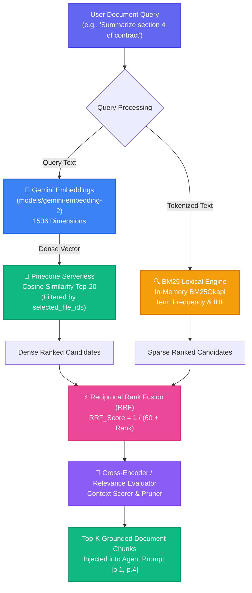

# 🌲 AutoFlow Vector Database & Hybrid RAG Architecture

Comprehensive specifications for **AutoFlow's Hybrid Document Retrieval-Augmented Generation (RAG)** pipeline powered by **Pinecone Serverless**, **BM25 Lexical Ranking**, **Google Gemini Embeddings**, and **LlamaCloud OCR**.

---

## 1. Hybrid Search Architecture Overview

AutoFlow implements a **Two-Stage Hybrid Search Pipeline** combining dense semantic vectors with sparse lexical keyword matching:



### Why Hybrid Search?
- **Dense Vectors (Semantic Understanding)**: Excel at conceptual queries, synonyms, and conversational paraphrasing (e.g., finding clauses regarding "ending employment" when the document says "termination of agreement").
- **Sparse BM25 (Exact Keyword Match)**: Prevents semantic drift when queries target specific model numbers, acronyms, monetary values, or legal entity names (e.g., "Section 14.2(b)", "$2,450.00").
- **Reciprocal Rank Fusion (RRF)**: Merges disparate score scales into an equitable positional rank without requiring hyperparameter calibration.

---

## 2. Pinecone Index Configuration

| Parameter | Value | Description |
| :--- | :--- | :--- |
| **Index Name** | `autoflow-docs` | Configured via `PINECONE_INDEX_NAME` in `.env`. |
| **Vector Dimension** | `1536` | Matches `models/gemini-embedding-2` vector output. |
| **Metric** | `cosine` | Cosine similarity for angle-based semantic alignment. |
| **Cloud Provider** | `aws` / `gcp` | Configured for serverless low-latency deployments. |
| **Namespacing** | Optional per-user | Enforces hard multi-tenant boundary isolation. |

---

## 3. Safe 32KB Document Chunking Pipeline

Pinecone enforces a strict **40,960-byte (40 KB) hard limit** on total metadata payload per vector. Large pages or multi-row Markdown tables can easily exceed this ceiling, resulting in rejected upserts.

AutoFlow introduces the **Safe 32KB Slicing Algorithm** (`services/rag_service.py`):

```python
MAX_PAGE_CHUNK_BYTES = 32000

def split_page_into_parts(text: str, max_bytes: int = MAX_PAGE_CHUNK_BYTES) -> List[str]:
    """
    Slices pages exceeding 32,000 UTF-8 bytes into 2 or more sub-parts.
    Prioritizes double newlines (\n\n) for paragraphs, falling back to 
    single newlines (\n) for giant tables to ensure no data loss.
    """
    cleaned = (text or "").strip()
    text_bytes = len(cleaned.encode("utf-8"))
    if text_bytes <= max_bytes:
        return [cleaned]

    # Bisect at paragraph boundaries
    paragraphs = cleaned.split("\n\n")
    parts: List[str] = []
    current_chunk: List[str] = []
    current_size = 0

    for para in paragraphs:
        para_size = len((para + "\n\n").encode("utf-8"))
        if current_size + para_size > max_bytes and current_chunk:
            parts.append("\n\n".join(current_chunk).strip())
            current_chunk = [para]
            current_size = para_size
        else:
            current_chunk.append(para)
            current_size += para_size

    if current_chunk:
        parts.append("\n\n".join(current_chunk).strip())
    return parts
```

---

## 4. Vector Metadata Schema

Every vector upserted to Pinecone stores exhaustive contextual metadata:

```json
{
  "id": "doc-uuid-5678_p1_c0",
  "values": [0.0124, -0.0451, 0.0892, "... 1536 floats ..."],
  "metadata": {
    "user_id": "usr-uuid-0001",
    "file_id": "doc-uuid-5678",
    "filename": "Financial_Statement_Q3.pdf",
    "page_number": 1,
    "chunk_index": 0,
    "total_chunks_on_page": 1,
    "ocr_tier": "agentic",
    "text": "### Balance Sheet as of September 30, 2026\n| Asset | Value |...",
    "indexed_at": "2026-11-26T23:55:00Z"
  }
}
```

---

## 5. Reciprocal Rank Fusion (RRF) Implementation

The RRF algorithm scores items based on their ordinal position in both the dense and sparse candidate lists:

$$\text{RRF Score}(d) = \sum_{m \in \{\text{Dense}, \text{BM25}\}} \frac{1}{k + \text{rank}_m(d)}$$

Where $k = 60$ (standard smoothing constant):

```python
def merge_rrf(
    dense_results: List[Dict[str, Any]], 
    bm25_results: List[Dict[str, Any]], 
    k: int = 60
) -> List[Dict[str, Any]]:
    scores: Dict[str, float] = {}
    chunk_map: Dict[str, Dict[str, Any]] = {}

    for rank, item in enumerate(dense_results):
        cid = item["chunk_id"]
        chunk_map[cid] = item
        scores[cid] = scores.get(cid, 0.0) + (1.0 / (k + rank + 1))

    for rank, item in enumerate(bm25_results):
        cid = item["chunk_id"]
        if cid not in chunk_map:
            chunk_map[cid] = item
        scores[cid] = scores.get(cid, 0.0) + (1.0 / (k + rank + 1))

    # Sort descending by fused RRF score
    sorted_cids = sorted(scores.keys(), key=lambda x: scores[x], reverse=True)
    return [chunk_map[cid] for cid in sorted_cids]
```

---

## 6. Document Ingestion Lifecycle

```
1. Client Upload (PDF/Image)
        │
        ▼
2. SHA-256 Deduplication Check (Bypasses re-parsing if exact file exists)
        │
        ▼
3. LlamaCloud OCR Parsing (Fast tier for text; Agentic tier for complex tables)
        │
        ▼
4. Page-by-Page JSONB Extraction & DB Record Creation
        │
        ▼
5. Safe 32KB Sub-Page Chunking (MAX_PAGE_CHUNK_BYTES = 32000)
        │
        ▼
6. Gemini Batch Embeddings Generation (models/gemini-embedding-2)
        │
        ▼
7. Pinecone Serverless Upsert (Batches of 100 vectors)
        │
        ▼
8. Status Transition to 'digitized' (Ready for Chat RAG Retrieval)
```

---

## 7. Next Steps & Related Documentation
* 🏛️ **[System Architecture](architecture.md)**: High-level overview and data flow.
* 🔄 **[Agents Flow & Reasoning](agents-flow.md)**: State graph logic and retrieval tool usage.
* 📡 **[Full API Reference](apis.md)**: Document upload, indexing, and chat endpoints.
* 💾 **[Database Architecture](database.md)**: PostgreSQL schemas, tables, and Supabase RLS.
* ⚙️ **[Configuration & Setup Guide](configuration.md)**: Pinecone credentials and environment keys.
